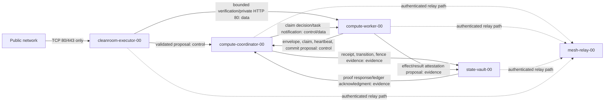

# Level 3 Network Overlay Specification

Status: **Draft for independent review**

Specification version: **0.1.0-draft**

Inspection baseline: Recursive Field commit `cf672c19f848271286572fdaec22f165e3b68d93`

Queue semantics dependency: [Level 3 Distributed Task Queue Specification](LEVEL_3_DISTRIBUTED_QUEUE_SPEC.md)

## Specification frame

### Scope, vantage, and stopping boundary

This document specifies the network and identity constraints required to project the Level 3 distributed queue contract across five logical node roles. Its vantage is the source checkout at the inspection baseline, not a live network. It covers logical coordinates, address allocation policy, authenticated private transport, directional routes, ingress separation, firewall intent, node rehydration, and provider-agnostic verification evidence.

This specification stops before transport selection, address assignment, key generation, DNS publication, firewall application, interface creation, service deployment, or node activation. Tailscale and operator-managed WireGuard remain unresolved alternatives. No statement in this document is proof of live infrastructure state.

### Authority and evidence classes

The following classes MUST remain distinct:

- **Documentary evidence**: behavior or declarations found in the inspected source files.
- **Proposed contract**: requirements expressed by **MUST**, **MUST NOT**, **SHOULD**, and **MAY** in their usual standards sense.
- **Declared state**: intended identity or topology that has not yet passed activation evidence.
- **Observed state**: a bounded observation from an identified verifier and time.
- **Attested state**: an observation bound to identity, epoch, configuration digest, and signer.
- **Verified state**: attested evidence accepted against this specification's acceptance rules.
- **Simulation**: a model or test result that does not prove live state.

The queue authority and fencing semantics are inherited without modification from the Level 3 queue specification. `compute-coordinator-00` is the designated logical role for that authority, but a route to that node does not prove authority, exclusivity, CAS correctness, epoch continuity, or fencing safety. The durable ledger and effect-attestation anchor is `state-vault-00`; its copies do not become lifecycle authority merely by receiving records.

### The `-00` origin motif

The suffix `-00` is the zero-to-one genesis coordinate: the first stable logical member of a role family. It is not an assertion that any provider instance has already been renamed, rehydrated, enrolled, or bound to that coordinate. The origin coordinate remains stable while physical resources, addresses, overlay keys, DNS labels, boots, and deployment generations change around it.

The authoritative origin taxonomy is:

| Logical coordinate | Declared role |
| --- | --- |
| `compute-coordinator-00` | CAS lease and fencing-token authority |
| `mesh-relay-00` | Private transport relay and signal mesh |
| `state-vault-00` | Durable ledger and effect-attestation anchor |
| `cleanroom-executor-00` | Public ingress, TLS termination, and isolated verifier |
| `compute-worker-00` | Origin unit-cell container host |

All five coordinates are declarations at this specification boundary. The four snapshot-backed roles that are not the current executing host MUST remain `declared`, not observed or verified active, until rehydration attestation succeeds. A provider-named current host does not acquire `compute-coordinator-00` merely because it performs coordinator-like work.

### Assumptions, exclusions, and threat model

Assumptions:

- Each accepted logical coordinate has exactly one active binding in one formation generation.
- The binding authority can sign or otherwise authenticate immutable coordinate-binding and revocation records.
- Nodes possess hardware-, operating-system-, or software-protected overlay credentials whose provenance can be audited.
- The selected transport can authenticate peers and encrypt traffic in transit.
- Service authorization is evaluated independently of routing and address possession.

Exclusions:

- Selection or configuration of Tailscale, WireGuard, a DNS provider, a cloud firewall, a certificate authority, a queue substrate, or a ledger substrate.
- Real addresses, provider resource identifiers, credentials, secrets, live ports other than the established HTTP semantics described below, and executable actuation commands.
- A claim of exactly-once effects, global network availability, relay confidentiality against endpoints, or current snapshot readiness.

Threats in scope include cloned snapshots, stolen or replayed overlay credentials, stale coordinate bindings, duplicate active coordinates, compromised relays, route or ACL drift, address collisions, spoofed DNS, compromised workers, stale queue writers, public exposure of private roles, downgrade during key rotation, and incomplete rehydration. A compromised endpoint can misuse its own granted capabilities; therefore no transitive trust is inferred from mesh membership, successful routing, a private address, a relay path, or another node's trust decision.

### Versioning and normative language

This draft uses semantic versioning. A major version changes accepted identity, binding, route, or security meaning. A minor version may add optional fields or service classes without weakening existing requirements. A patch version clarifies wording or validation while preserving accepted meaning. Published schemas and policy bundles SHOULD be immutable and content-addressed. An implementation MUST reject unsupported major versions before enrollment or actuation.

## 1. Node Identity vs IP Identity

### 1.1 Separate namespaces

A conforming deployment MUST treat these as separate namespaces:

1. **Logical coordinate**: stable role-family coordinate, such as `compute-worker-00`.
2. **Role identity**: the authorized behavior and capability set bound to that coordinate.
3. **Formation generation and role epoch**: monotonic lineage coordinates that prevent stale identity reuse.
4. **Provider resource identity**: provider-issued instance or resource identifier.
5. **Overlay cryptographic identity**: public-key fingerprint or transport-issued node identity.
6. **DNS label**: mutable discovery locator with authenticated provenance and bounded lifetime.
7. **Overlay and underlay addresses**: mutable routing locators.
8. **Boot identity**: one operating-system incarnation.
9. **Workload identity**: process, container, service, or adapter identity within the node.

Equality in one namespace MUST NOT imply equality in another. In particular, an address, reverse-DNS result, provider display name, snapshot name, host name, or reachable service MUST NOT by itself establish a logical coordinate.

### 1.2 Coordinate grammar and allocation

The logical coordinate grammar is:

```text
^(compute-coordinator|mesh-relay|state-vault|cleanroom-executor|compute-worker)-[0-9]{2,}$
```

The decimal suffix is zero-based, fixed to at least two digits, and MUST NOT be omitted. The role prefix is immutable for the lifetime of a coordinate. Scale-out allocates the next unused ordinal in the same role family; it never renames the origin member or uses a one-based alias for it.

The five origin coordinates in this draft are the only coordinates authorized by its baseline topology. Additional siblings require a separately accepted allocation record and policy revision; grammar validity alone grants no membership or routes.

### 1.3 Signed coordinate-binding record

A logical coordinate becomes usable only through an immutable binding record accepted by the formation's identity-binding authority. The record MUST bind the coordinate, role, formation identity, formation generation, role epoch, provider resource identity, overlay cryptographic identity, boot identity, DNS labels if any, address-set digest, configuration digest, snapshot or image provenance, validity interval, predecessor, signer, and signature reference.

When a coordinate participates in the queue or ledger planes, the same signed binding MUST also bind the queue `authority_id`, `partition_id`, exact owner tuple `{DROPLET_ID}:{CONTAINER_SLUG}:{boot_id}`, authority epoch, queue capability scope, ledger capability scope, and the digest of the accepted queue/ledger authorization policy. `compute-coordinator-00` is the only coordinate that may hold queue-CAS, lease-fencing, and terminal-lifecycle capabilities. `state-vault-00` may hold only authenticated evidence-recording and proof-query capabilities; its binding MUST explicitly exclude queue CAS, lease issuance, and terminal lifecycle decisions. A provider resource, overlay identity, address, or legacy label without this signed cross-namespace binding MUST fail closed.

Non-authoritative example:

```json
{
  "schema_name": "recursive-field.node-coordinate-binding",
  "schema_version": "1.0.0",
  "formation_id": "example-formation",
  "formation_generation": 12,
  "logical_coordinate": "compute-coordinator-00",
  "role": "queue_fencing_authority",
  "role_epoch": 8,
  "provider": {
    "kind": "provider-neutral",
    "resource_identity_sha256": "1111111111111111111111111111111111111111111111111111111111111111"
  },
  "overlay_identity": {
    "kind": "transport-neutral-public-key",
    "public_key_sha256": "2222222222222222222222222222222222222222222222222222222222222222"
  },
  "boot_id_sha256": "3333333333333333333333333333333333333333333333333333333333333333",
  "dns_labels": [],
  "address_set_sha256": "4444444444444444444444444444444444444444444444444444444444444444",
  "configuration_sha256": "5555555555555555555555555555555555555555555555555555555555555555",
  "provenance_sha256": "6666666666666666666666666666666666666666666666666666666666666666",
  "queue_binding": {
    "authority_id": "queue-authority/example-formation/0",
    "partition_id": "example-formation/0",
    "owner": {
      "droplet_id": "provider-resource-placeholder",
      "container_slug": "compute-coordinator-00",
      "boot_id_sha256": "3333333333333333333333333333333333333333333333333333333333333333"
    },
    "authority_epoch": 8,
    "queue_capabilities": ["queue-cas", "lease-fencing", "terminal-lifecycle-cas"],
    "ledger_capabilities": ["evidence-recording", "proof-query"],
    "authorization_policy_sha256": "1212121212121212121212121212121212121212121212121212121212121212"
  },
  "valid_from": "2030-07-10T00:00:00Z",
  "valid_until": "2030-07-11T00:00:00Z",
  "predecessor_binding_sha256": null,
  "signer": "formation-identity-authority",
  "signature_ref": "detached-signature:example"
}
```

Placeholder hashes and times do not verify. A binding MUST be rejected if its coordinate is already active under another unrevoked provider or overlay identity, its epoch is not greater than the retired predecessor when replacement is occurring, or its provenance and boot evidence do not satisfy section 9.

### 1.4 Legacy and scale-out migration discussion

Previously discussed or deployed names ending in `-01` are legacy or provider labels unless a signed coordinate-binding record explicitly adopts them as logical coordinates. A provider-named `compute-coordinator-01` MUST NOT be silently equated with, renamed to, or treated as evidence for `compute-coordinator-00`. Migration requires an explicit old-label disposition, a new binding record, overlap prevention, and audit evidence.

After the origin, deterministic siblings use increasing zero-based ordinals (`-01`, `-02`, and onward) without renaming `-00`. This numbering rule does not retroactively adopt a historical label: a historical `-01` and a newly allocated sibling with the same text remain distinct claims until binding authority and formation lineage resolve them. No compatibility alias may route privileged traffic or confer authority.

## 2. Private Address Allocation & Reserved Scaling Ranges

### 2.1 Provider-agnostic allocation model

Addresses are mutable locators allocated only after logical identity is accepted. The address authority MUST maintain one canonical allocation registry per formation generation. Allocation MUST be transactional or conflict-detecting, bind each address to one active coordinate and overlay identity, and preserve tombstones long enough to reject stale peers and DNS caches.

No real or live address is assigned by this specification. Instead, the selected transport profile MUST declare:

- transport and address family;
- authoritative address source;
- formation prefix or provider-assigned pool reference;
- role-family ranges;
- ordinal-to-address derivation or reservation method;
- excluded, gateway, broadcast, relay, and infrastructure reservations;
- collision-detection procedure;
- DNS publication rules;
- reassignment quarantine interval;
- IPv6 policy;
- registry epoch and content digest.

### 2.2 Tailscale and WireGuard constraints

Tailscale commonly uses addresses from the CGNAT block `100.64.0.0/10` under its control-plane allocation model. A deployment selecting Tailscale MUST treat assigned overlay addresses as transport-managed locators and MUST NOT derive role authority from them. Operator underlays, container networks, and VPN pools MUST be checked for collision with that block and with routes advertised into the tailnet.

An operator-managed WireGuard deployment requires an operator-owned, non-overlapping private or otherwise legitimately assigned prefix. Its address registry, route distribution, key lifecycle, and collision prevention remain operator responsibilities. WireGuard configuration does not inherently supply a node directory, policy distribution, DNS, enrollment workflow, or global relay service.

The two models MUST NOT be treated as interchangeable. Their control planes, address ownership, relay behavior, DNS integration, route advertisement, key lifecycle, and ACL semantics differ. A deployment MUST select one authoritative overlay address model for a routing domain. It MUST NOT assign an operator WireGuard subnet that overlaps Tailscale's CGNAT range, an underlay, a container bridge, a provider private network, a recovery network, or any imported route.

### 2.3 Reserved role and ordinal ranges

The address plan MUST reserve disjoint ranges for these role families, in this order:

1. queue/fencing authorities, beginning with `compute-coordinator-00`;
2. transport relays, beginning with `mesh-relay-00`;
3. ledger/evidence anchors, beginning with `state-vault-00`;
4. cleanroom/public gateways, beginning with `cleanroom-executor-00`;
5. workers, beginning with `compute-worker-00`;
6. management/recovery identities;
7. future infrastructure and test identities.

The concrete prefix lengths and addresses are unresolved. Ordinal allocation MUST be deterministic within each reserved family, but an ordinal MUST NOT be converted to an address until collision checks pass and the allocation registry commits the binding. Reserved capacity SHOULD permit growth without renumbering the origin coordinates.

Non-authoritative address-plan example:

```json
{
  "schema_name": "recursive-field.overlay-address-plan",
  "schema_version": "1.0.0",
  "formation_generation": 12,
  "transport_profile": "unresolved",
  "address_authority": "formation-address-authority",
  "prefix_reference": "operator-or-transport-assigned-prefix",
  "role_ranges": [
    {"role": "compute-coordinator", "origin_coordinate": "compute-coordinator-00", "range_ref": "range-a"},
    {"role": "mesh-relay", "origin_coordinate": "mesh-relay-00", "range_ref": "range-b"},
    {"role": "state-vault", "origin_coordinate": "state-vault-00", "range_ref": "range-c"},
    {"role": "cleanroom-executor", "origin_coordinate": "cleanroom-executor-00", "range_ref": "range-d"},
    {"role": "compute-worker", "origin_coordinate": "compute-worker-00", "range_ref": "range-e"}
  ],
  "ipv6_policy": "reserved-unassigned",
  "collision_domains": ["overlay", "underlay", "container", "provider-private", "recovery", "imported-routes"],
  "registry_epoch": 4,
  "plan_sha256": "7777777777777777777777777777777777777777777777777777777777777777"
}
```

### 2.4 IPv6 and collision detection

IPv6 SHOULD be planned even if initially disabled. A dual-stack deployment MUST apply equivalent authentication, route, firewall, DNS, logging, and exposure policy to both families; disabling IPv4 controls while leaving IPv6 permissive is nonconforming. Link-local addresses MUST NOT be used as formation identity.

Before allocation or route acceptance, the authority MUST compare the proposed prefix and host allocation against every overlay, underlay, provider-private, container, service, recovery, and imported route known to the formation. It MUST reject exact collisions, covering-prefix collisions, covered-prefix collisions, duplicate host allocations, and ambiguous route advertisements. The proof MUST record the compared route-set digest, registry epoch, decision, and signer. Collision-free simulation is necessary but not proof that a live routing table matches the tested input.

## 3. Transport-Neutral Trust Requirements

### 3.1 Baseline trust properties

The selected overlay MUST provide mutually authenticated and encrypted peer transport with modern cryptography, replay resistance appropriate to the protocol, authenticated key exchange, and explicit peer revocation. Every connection MUST be authorized by current logical coordinate, role, formation generation, role epoch, workload identity where applicable, and requested service class. An IP address, route, DNS label, provider tag, or successful handshake alone MUST NOT authorize an operation.

Key provenance MUST answer who or what generated the key, where private material is stored, which binding record names its public identity, when it became valid, which epoch it belongs to, and how revocation is distributed. Private key material MUST NOT appear in queue envelopes, ledgers, logs, DNS, images, snapshots, or this specification's policy records.

### 3.2 Enrollment and identity binding

Enrollment MUST be a closed sequence:

1. verify provider or recovery identity without trusting its display name;
2. verify image or snapshot provenance;
3. establish a fresh boot identity;
4. generate or provision a fresh overlay identity through an approved key path;
5. obtain a signed coordinate binding for the intended role epoch;
6. install only the routes and service capabilities required by that role;
7. prove negative access to prohibited service classes;
8. record attestation evidence before activation.

Snapshot-carried overlay private keys MUST be replaced before network attachment. A node MUST NOT self-assign a privileged coordinate. Enrollment approval and route-policy approval SHOULD be separable capabilities.

### 3.3 Least privilege and no transitive trust

Trust is edge-specific and service-specific. If `compute-worker-00` may submit a claim proposal to `compute-coordinator-00`, it does not follow that it may read authority storage, reach `state-vault-00` management services, use `mesh-relay-00` as a general-purpose exit, or access `cleanroom-executor-00` administration. A trusted relay does not make relayed peers mutually trusted.

`mesh-relay-00` MUST be treated as potentially able to observe traffic metadata and disrupt availability. End-to-end peer authentication and encryption MUST terminate at the intended service endpoints whenever the chosen transport supports it; relay compromise MUST NOT grant queue authority, ledger signing authority, endpoint private keys, plaintext application credentials, or automatic access to other routes. Relay-only credentials MUST be unable to mint node bindings or broaden ACLs.

### 3.4 Rotation and revocation

Node, transport-control, DNS-signing, TLS, workload, and evidence-signing keys MUST have separate identifiers and revocation scopes. Rotation MUST support overlap only for a bounded, recorded interval and MUST preserve verification of retained evidence without preserving actuation rights for retired keys. Revocation MUST remove route and service authorization, invalidate enrollment sessions, publish a signed revocation record, and trigger policy convergence checks.

A compromised active key requires immediate fail-closed isolation of the affected coordinate, role-epoch advancement where authority could be affected, and explicit reconciliation of any queue, fence, ledger, or effect records signed during the exposure window. Restoring network reachability alone MUST NOT restore authority.

## 4. Allowed Directional Flows & Port Matrix

### 4.1 Plane separation

The topology has five planes that MUST be separately identifiable in policy and evidence:

- **Control plane**: coordinate binding, enrollment, policy distribution, queue CAS, lease renewal, and fencing decisions.
- **Data plane**: immutable task envelopes, bounded result proposals, application requests, and internal agent HTTP.
- **Public ingress plane**: public TCP 80/443 termination exclusively at `cleanroom-executor-00`.
- **Management/recovery plane**: bounded operator access, diagnostics, break-glass recovery, and rehydration.
- **Evidence/ledger plane**: receipts, effect attestations, audit projections, signed checkpoints, and ledger verification.

A flow permitted in one plane MUST NOT imply permission in another. Management and recovery MUST use identities and policy distinct from workload traffic.

### 4.2 Normative service classes

Concrete queue, CAS, ledger, relay-control, enrollment, management, and attestation ports are unresolved because the source contracts do not define them. Policies MUST name service classes first and bind them to concrete protocols and ports only in an approved deployment profile.

Established generated-compose documentation preserves internal agent HTTP semantics on container port `80`. This MAY be carried privately from an authorized gateway or verifier to an agent workload when an approved route binds the exact workload identity. It MUST NOT become a general host-level public listener. Public TCP `80` and `443` are reserved exclusively for `cleanroom-executor-00`; port `80` SHOULD redirect to or support issuance for protected TLS on `443`, subject to the selected ingress profile.

### 4.3 Directional flow matrix

`ALLOW` means the deployment profile may bind the named service class after endpoint identity and authorization checks. It does not authorize every port or implementation.

| Source | Destination | Plane | Service class | Default |
| --- | --- | --- | --- | --- |
| `compute-worker-00` | `compute-coordinator-00` | Control | queue proposal, claim, heartbeat, commit proposal | `ALLOW` |
| `compute-coordinator-00` | `compute-worker-00` | Control/data | claim decision, bounded task notification, rejection evidence | `ALLOW` |
| `compute-coordinator-00` | `state-vault-00` | Evidence | accepted transition, receipt, fence and authority evidence | `ALLOW` |
| `compute-worker-00` | `state-vault-00` | Evidence | effect/result proposal only through an authenticated intake class | `ALLOW` |
| `state-vault-00` | `compute-coordinator-00` | Evidence | proof query response and ledger acknowledgment | `ALLOW` |
| `cleanroom-executor-00` | `compute-coordinator-00` | Control | validated ingress proposal; never direct authority mutation | `ALLOW` |
| `cleanroom-executor-00` | `compute-worker-00` | Data | isolated verification or private internal HTTP `80` when explicitly bound | `ALLOW` |
| `compute-coordinator-00` | `mesh-relay-00` | Control/data | transport relay service only | `ALLOW` |
| `mesh-relay-00` | `compute-coordinator-00` | Control/data | relayed packets for an already authorized endpoint pair | `ALLOW` |
| `state-vault-00` | `mesh-relay-00` | Control/data | transport relay service only | `ALLOW` |
| `mesh-relay-00` | `state-vault-00` | Control/data | relayed packets for an already authorized endpoint pair | `ALLOW` |
| `cleanroom-executor-00` | `mesh-relay-00` | Control/data | transport relay service only | `ALLOW` |
| `mesh-relay-00` | `cleanroom-executor-00` | Control/data | relayed packets for an already authorized endpoint pair | `ALLOW` |
| `compute-worker-00` | `mesh-relay-00` | Control/data | transport relay service only | `ALLOW` |
| `mesh-relay-00` | `compute-worker-00` | Control/data | relayed packets for an already authorized endpoint pair | `ALLOW` |
| `mesh-relay-00` | `mesh-relay-00` | Control/data | relay self-control only when required by the selected transport | `ALLOW` |
| public network | `cleanroom-executor-00` | Public ingress | TCP `80`, TCP `443` | `ALLOW` |
| public network | `compute-coordinator-00` | Public ingress | unsolicited ingress | `DENY` |
| public network | `mesh-relay-00` | Public ingress | unsolicited application ingress | `DENY` |
| public network | `state-vault-00` | Public ingress | unsolicited ingress | `DENY` |
| public network | `compute-worker-00` | Public ingress | unsolicited ingress | `DENY` |

The matrix is expanded only over the five declared `-00` coordinates. Every unlisted source/destination/service-class tuple is denied, including transitive forwarding. A sibling coordinate, provider label, legacy `-01` label, or management identity MUST NOT enter this matrix without its own signed binding, scoped capability policy, and separately accepted route expansion. Management/recovery flows are therefore governed by a distinct bounded policy and are not represented by a wildcard row here.

Relay transport reachability needed by the chosen overlay is not public application ingress. Any required relay-facing underlay listener MUST be documented in the transport profile, narrowly scoped, authenticated, and shown not to expose queue, ledger, workload, management, or ingress services.

### 4.4 Route and ACL policy schemas

A route policy MUST bind source and destination coordinates, role epochs or binding digests, plane, service class, direction, transport requirements, concrete endpoint binding when resolved, effect, expiration, and policy provenance. Wildcards over privileged roles SHOULD be prohibited. A default-deny rule MUST close every unlisted tuple.

Non-authoritative route-policy example:

```json
{
  "schema_name": "recursive-field.overlay-route-policy",
  "schema_version": "1.0.0",
  "policy_id": "worker-to-queue-authority",
  "source": "compute-worker-00",
  "destination": "compute-coordinator-00",
  "plane": "control",
  "service_class": "queue-cas-client",
  "direction": "initiated-by-source",
  "transport": {
    "mutual_authentication": true,
    "encryption": "required",
    "source_binding_required": true,
    "destination_binding_required": true
  },
  "endpoint_binding": {
    "protocol": "unresolved",
    "port": null
  },
  "effect": "allow",
  "expires_at": "2030-07-11T00:00:00Z",
  "policy_epoch": 6,
  "policy_sha256": "8888888888888888888888888888888888888888888888888888888888888888"
}
```

A policy compiler MUST reject an `allow` rule with an unresolved concrete endpoint at deployment time, even though such a rule is valid as a design-stage record.

Non-authoritative ACL bundle example:

```json
{
  "schema_name": "recursive-field.overlay-acl-bundle",
  "schema_version": "1.0.0",
  "formation_generation": 12,
  "coordinates": [
    "compute-coordinator-00",
    "mesh-relay-00",
    "state-vault-00",
    "cleanroom-executor-00",
    "compute-worker-00"
  ],
  "planes": ["control", "data", "public-ingress", "management-recovery", "evidence-ledger"],
  "rules_ref": "content-addressed-rule-set",
  "default_ingress": "deny",
  "default_egress": "deny",
  "transitive_forwarding": "deny",
  "policy_epoch": 6,
  "bundle_sha256": "9999999999999999999999999999999999999999999999999999999999999999"
}
```

## 5. Queue-Authority, Ledger, Relay, Gateway, and Worker Route Maps

### 5.1 Role projection

The network projects, but does not redefine, the Level 3 queue contract:

- `compute-coordinator-00` owns the designated CAS lease and fencing-token authority role. Its queue and authority epochs, monotonic lease rules, high-water registers, and four-step protocol remain governed by the queue specification.
- `state-vault-00` records only authenticated proposals, evidence receipts, pre-receipt effect attestations, and proof-query results. It MUST NOT assert lifecycle truth, grant leases, perform queue CAS, advance task state, or issue terminal lifecycle decisions merely because it stores an authority record.
- `compute-worker-00` proposes envelopes, claims, heartbeats, results, and attestations under current bindings and fences. Local state is not authority.

- `cleanroom-executor-00` terminates public ingress and performs isolated verification. It cannot bypass queue acceptance or write an unfenced terminal effect.
- `mesh-relay-00` supplies private transport relay and signaling. It is neither an application proxy with ambient credentials nor an authority replica.

The coordinator-to-vault route MUST carry the signed cross-namespace binding, current `authority_id`, `partition_id`, authority epoch, task/claim/lease/sink-fence digests, and the coordinator capability proof. The vault MUST verify those bindings, append an immutable evidence receipt, and return a signed receipt/proof digest; it MUST NOT perform or simulate the queue CAS. The coordinator alone MUST validate the evidence and perform the queue state-pointer CAS and terminal lifecycle decision. A worker-to-vault proposal is evidence input only and cannot become ledger or lifecycle truth without coordinator validation under the current authority and sink fences.

### 5.2 Plane and route diagram



Dashed relay edges describe possible transport paths, not trusted application hops. The relay MUST NOT terminate queue authority, ledger signing, workload authorization, or endpoint identity on behalf of the named endpoints.

### 5.3 Queue and effect route sequence

```mermaid
sequenceDiagram
    participant CE as cleanroom-executor-00
    participant CC as compute-coordinator-00
    participant CW as compute-worker-00
    participant SV as state-vault-00
    participant MR as mesh-relay-00
    Note over CE,MR: Transport may traverse mesh-relay-00; endpoint authorization remains end to end
    CE->>CC: Validated ingress proposal
    CW->>CC: Step 1 slot and claim-reservation proposal
    CC-->>CW: Step 2 fence/register/state-CAS decision
    CC->>SV: Authenticated authority/evidence append request
    SV-->>CC: Signed evidence receipt; no lifecycle CAS
    CW->>SV: EFFECT_ATTEMPTED and pre-receipt attestation proposal
    SV-->>CC: Sink proof coordinate and digest
    CC->>CC: Step 4 terminal receipt and lifecycle CAS
    CC-->>CE: Bounded result or status projection
```

Every transition shown is conditional on the inherited queue specification. Network delivery is at-least-once and MAY duplicate, delay, or reorder messages. The receiver MUST use immutable identity, digest, CAS, receipt, and fencing rules rather than transport ordering.

### 5.4 Route invariants

1. A worker route to the coordinator MUST NOT permit direct access to authority storage or high-water registers.
2. A coordinator route to the vault MUST distinguish authenticated evidence append, proof query, replication, and management service classes.
3. `state-vault-00` MUST record authenticated proposals and evidence receipts only; it MUST NOT perform queue CAS, assert lifecycle truth, grant leases, or issue terminal decisions.
4. A worker's attestation proposal MUST NOT become accepted ledger or lifecycle truth until `compute-coordinator-00` validates its task, claim, epoch, lease token, sink fence, and effect proof, then performs the required queue CAS.
5. Every coordinator/vault evidence receipt MUST bind the signed cross-namespace coordinate, `authority_id`, `partition_id`, authority epoch, task/claim/lease/sink-fence digests, and coordinator capability proof.
6. Public ingress MUST pass through `cleanroom-executor-00`; public clients MUST NOT address authority, relay, vault, or worker service identities.
7. The relay MUST NOT provide general subnet transit, unrestricted exit, peer-to-peer ambient reachability, or policy-bypass routes.
8. DNS resolution MUST be checked against the signed coordinate binding before privileged connection establishment.
9. Route availability MUST NOT be interpreted as lease validity, authority continuity, or permission to replay an effect.

## 6. Partition, Relay-Loss, Key-Rotation, and Node-Rehydration Behavior

### 6.1 Partition behavior

A node that cannot reach `compute-coordinator-00` loses the ability to acquire, renew, or commit queue authority. A partitioned `compute-worker-00` MAY checkpoint pure local computation, but any later result is only a proposal and MUST be rejected if its claim, authority epoch, lease generation, sink fence, boot identity, or binding is stale.

If `compute-coordinator-00` cannot reach `state-vault-00`, it MUST NOT issue a terminal receipt where the queue specification requires durable effect-attestation or ledger proof. Work may remain pending, claimed, ambiguous, or reconciliation-required according to that specification; network availability MUST NOT weaken the classification.

On coordinator restart, authority failover, or monotonic-clock discontinuity, `compute-coordinator-00` MUST freeze claims, renewals, takeovers, queue CAS, and consequential writes. It MUST use a restart-stable monotonic continuity proof; absent that proof, it MUST wait at least the maximum remaining lease duration plus the configured uncertainty margin before resuming. Recovery MUST restore every queue/task and protected-sink high-water register from immutable durable `state-vault-00` logs and accepted receipts, invalidate prior renewals, advance the authority epoch, and prevent the stale authority from reaching any consequential sink. Claims and consequential writes remain fail-closed until one exclusive authority and one strictly monotonic token sequence are proved. `state-vault-00` supplies durable evidence and receipts for this recovery but MUST NOT perform the recovery CAS or declare lifecycle truth.

If `cleanroom-executor-00` loses private authority reachability, public requests that require queue or ledger action MUST fail closed with a bounded unavailable response. It MUST NOT queue privileged work in an unauthenticated local substitute or route directly to a worker.

### 6.2 Relay loss and bypass

Loss of `mesh-relay-00` is an availability event, not authority failover. Direct peer paths MAY be used only if they were predeclared in the same authenticated route policy and preserve endpoint identity, encryption, service authorization, logging, and no-transitive-trust rules. Dynamic emergency subnet forwarding or policy bypass is prohibited.

If the selected transport requires the relay for control or data reachability and no approved direct path exists, affected flows stop. A replacement relay requires a fresh overlay identity, binding or role-epoch update as applicable, route-policy convergence, and negative testing before service.

### 6.3 Key rotation and compromise

Planned rotation MUST stage a new public identity, bind it to the same logical coordinate and a greater key generation, distribute policy, verify dual-key overlap where allowed, move connections, revoke the predecessor, and prove convergence. The overlap window MUST be bounded and MUST NOT permit two independent active provider instances for one coordinate.

On suspected compromise, affected traffic MUST be denied before re-enrollment. Queue and ledger principals MUST examine the exposure window for stale or forged claims, fence attempts, effect attestations, DNS changes, and policy modifications. Authority-related compromise requires role-epoch and, where the queue contract requires it, authority-epoch advancement. A rotated transport key does not by itself repair queue or evidence lineage.

### 6.4 Rehydration and stale snapshot rejection

A rehydrated node MUST begin isolated in `rehydrating`. It MUST use a fresh overlay key, fresh boot identity, and a role epoch greater than the retired or uncertain predecessor when exclusivity cannot be proven. Snapshot provenance, formation generation, configuration digest, durable volume identity, ledger head, queue high-water state where applicable, and revocation status MUST be checked before routes are enabled.

A snapshot MUST be rejected from activation if it contains reusable overlay private keys, stale authority epochs, an unverified ledger head, a conflicting active coordinate, an older formation generation without an approved migration, unknown provenance, or writable identity records that should be immutable. Rejection evidence MUST be preserved; operators MUST NOT delete contradictions to make rehydration appear clean.

### 6.5 Failure behavior matrix

| Event | Required behavior | Activation consequence |
| --- | --- | --- |
| Worker-to-authority partition | Stop claim/renew/commit; retain only bounded local checkpoint evidence | Worker may remain enrolled but cannot actuate queue effects |
| Authority-to-vault partition | Stop terminal receipt paths requiring durable attestation | Queue tasks remain nonterminal or enter explicit reconciliation state |
| Authority restart or monotonic discontinuity | Freeze claims, renewals, takeovers, CAS, and effects; prove clock continuity or wait through the uncertainty margin; restore all registers from durable vault logs; invalidate renewals; advance epoch; exclude stale authority | Fail closed until exclusive authority and one monotonic token sequence are proven |
| Relay loss | Use only preauthorized direct path or stop | No emergency transitive routing |
| Endpoint key compromise | Revoke route/service authorization; isolate coordinate | Fresh binding evidence required |
| Authority identity uncertainty | Freeze claims and consequential writes | Advance and prove lineage before resume |
| Snapshot boot with duplicate coordinate | Keep new instance isolated | One active coordinate must be proven |
| Stale DNS or address | Reject binding mismatch | Locator update cannot confer identity |
| Public gateway private-route loss | Fail closed for dependent requests | No direct public path to private roles |

## 7. Public vs Private Ingress Separation

### 7.1 Public boundary

Only `cleanroom-executor-00` MAY expose public TCP `80` and `443`. No other origin role may expose an unsolicited public application listener. Public `80` is limited to the approved HTTP redirect or certificate-validation behavior; application traffic SHOULD use authenticated TLS on `443`. TLS termination identity, certificate provenance, hostname policy, request limits, and upstream authorization remain deployment-profile requirements.

`cleanroom-executor-00` MUST be treated as an untrusted-to-private boundary even after request validation. It MUST authenticate private upstreams, present its own workload identity, use narrow service classes, strip untrusted identity headers, generate trusted identity context only after verification, and avoid carrying public source claims as authority facts.

### 7.2 Private roles

`compute-coordinator-00`, `mesh-relay-00`, `state-vault-00`, and `compute-worker-00` MUST default-drop unsolicited public ingress at cloud, host, overlay, and service layers where those layers exist. Private listeners MUST bind only to approved interfaces or identities. A provider public address, if operationally unavoidable, MUST have no permissive application rule for these roles.

Internal agent HTTP on container port `80` remains private and identity-bound. It MUST NOT be published directly on a public host interface. The existence of a generated Compose gateway pattern in documentary sources does not override this Level 3 separation.

### 7.3 Outbound and management paths

Outbound access MUST be allowlisted by role and purpose. Examples of distinct classes include transport coordination, certificate status or issuance, approved package or image retrieval, time synchronization, identity attestation, queue/ledger traffic, and bounded observability export. General internet egress is not implied.

Management/recovery paths MUST originate from authenticated management identities, use a separate service class, be time-bounded, logged, and incapable of silently inheriting workload credentials. Break-glass access MUST require explicit authorization, short validity, post-use revocation, and a signed review record. Public administration interfaces are prohibited by default.

### 7.4 DNS and proxy boundaries

Public DNS MAY name only the cleanroom ingress service unless a reviewed exception documents a non-application transport need. Private DNS records are locators and MUST be validated against coordinate bindings. Split-horizon or overlay DNS MUST not make a private role public through fallback resolution.

A reverse proxy MUST use exact upstream identities, not suffix matching or unconstrained service discovery. Forwarded client headers are untrusted until normalized at the cleanroom boundary. No proxy may convert network location into queue principal, agent identity, capability, lease ownership, or effect authority.

## 8. Firewall & Least-Privilege Enforcement

### 8.1 Layered enforcement

Conforming enforcement SHOULD use independent layers where available:

1. provider or cloud firewall;
2. host firewall;
3. overlay ACL or peer policy;
4. container or workload network policy;
5. service authentication and authorization.

Each layer MUST default deny inbound traffic not explicitly required. Stateful return traffic MAY be allowed for an authorized initiation, but it MUST NOT create a new initiation right in the reverse direction. A missing layer MUST be documented with compensating controls and a constraint shadow; the existence of another layer is not automatically sufficient.

### 8.2 Rule ownership and compilation

Human policy MUST be expressed in coordinate-, plane-, and service-class terms, then compiled to transport-specific addresses, identities, protocols, and ports from accepted binding records. Rules MUST include policy epoch, owner, reason, expiration where temporary, and source specification digest. Compilation MUST fail if a coordinate has no current binding, a service class has no concrete endpoint, an address collides, or a wildcard would broaden privileged access.

The desired-policy digest, compiled-rule digest, applied-rule observation, and independent reachability test MUST be separate evidence. An API success response or syntactically valid rule set is not proof of effective enforcement.

### 8.3 Egress, management, and logging

Egress policy MUST deny spoofed source addresses, unauthorized forwarding, unapproved DNS, and unrestricted transit through `mesh-relay-00` or `cleanroom-executor-00`. Management egress and workload egress MUST be distinguishable. Nodes SHOULD use authenticated time and name-resolution paths consistent with the selected threat model.

Logs MUST record policy epoch, rule identifier, source and destination coordinate when resolvable, service class, decision, transport identity, observed locator, timestamp, and correlation identifier. Logs MUST exclude private keys, bearer credentials, sensitive payloads, and unnecessary public client data. Deny logs SHOULD be rate-limited without hiding sustained attack or drift signals.

### 8.4 Drift detection and rollback

Drift detection MUST compare desired policy, compiled transport policy, observed effective listeners/routes, and active binding records. It MUST detect unexpected public listeners, permissive wildcards, stale coordinates, expired exceptions, route advertisements, IPv6 bypass, and divergence among firewall layers.

Every policy change MUST have a tested rollback that restores the previous known-good policy bundle without restoring revoked identities or stale coordinate bindings. If rollback would reopen a known compromise, the safe state is isolation, not automatic reversion. Failed or partially applied policy MUST fail closed and emit reconciliation evidence.

No firewall or network actuation command is defined by this specification.

## 9. Snapshot-to-Node Identity Restoration

### 9.1 Lifecycle

A snapshot-backed role moves through exactly these states:

`declared -> rehydrating -> attested -> active`

It MAY move from any non-retired state to `quarantined`, and from `active` to `retired`. It MUST NOT skip `attested`. `declared` means topology intent only. `rehydrating` permits isolated inspection but no production routes. `attested` means the required evidence bundle passed verification but activation policy has not yet committed. `active` means one current coordinate binding and its routes are enabled.

The phrase “four non-active snapshot-backed roles” is a topology assumption referring to the four origin roles other than the current executing host; this document does not identify or attest that host. All five origin coordinates remain declared at this specification boundary unless an individual role's signed rehydration evidence succeeds. No collective inference from one successful node is permitted.

### 9.2 Required restoration evidence

The rehydration evidence bundle MUST include:

- logical coordinate and role;
- formation identity and generation;
- genesis or formation identity proof;
- provider resource identity digest;
- source image or snapshot provenance and digest;
- attached durable-volume identity and read/write intent;
- fresh boot identity;
- fresh overlay public identity and proof that snapshot-carried private identity is absent or revoked;
- configuration, policy, and expected-service digests;
- signed coordinate binding with a valid role epoch and queue/ledger cross-namespace capability scopes;
- predecessor retirement or isolation proof;
- ledger head, accepted-receipt log rebuild, gap classification, reconciliation-receipt set, and volume consistency proof for `state-vault-00`;
- queue authority epoch, monotonic-clock continuity or mandatory recovery-wait evidence, every queue/task and protected-sink high-water register restored from durable vault logs, invalidated prior renewals, and old-authority exclusion proof for `compute-coordinator-00`;
- proof of one exclusive monotonic authority and strictly increasing queue/token sequence before resumption;
- ingress certificate and public exposure proof for `cleanroom-executor-00`;
- relay-only capability and no-transit-bypass proof for `mesh-relay-00`;
- workload identity, mount, and no-authority proof for `compute-worker-00`;
- verifier identity, observation time, result, and signature reference.

### 9.3 Fencing and duplicate prevention

Rehydrating `compute-coordinator-00` MUST follow the queue specification's authority recovery procedure. It MUST freeze claims, renewals, takeovers, and consequential writes; prove monotonic-clock continuity or complete the mandatory recovery wait plus uncertainty margin; restore every queue/task and protected-sink high-water register from durable `state-vault-00` logs and accepted receipts; invalidate prior renewals; advance the authority epoch; exclude the stale authority; and ensure the first new token is greater than every predecessor high-water mark. Network isolation alone is not sufficient if the predecessor may still reach a consequential sink.

Before any role becomes active, the binding authority MUST prove that no other active provider instance, overlay identity, boot identity, or policy bundle claims the same logical coordinate. Recovery MUST rebuild lifecycle state from accepted receipts, classify every gap as projection loss, `RECONCILIATION_REQUIRED`, or `AMBIGUOUS`, issue reconciliation receipts for repairs, and prove one exclusive monotonic authority and one strictly increasing token sequence. Ambiguous predecessor state keeps the candidate quarantined. No role may become active, and no DNS, route, or firewall activation may occur, before the candidate is attested and the binding commit succeeds. Activation MUST be rolled back if post-activation duplicate detection fails.

### 9.4 Rehydration-attestation example

```json
{
  "schema_name": "recursive-field.node-rehydration-attestation",
  "schema_version": "1.0.0",
  "logical_coordinate": "state-vault-00",
  "role": "ledger_effect_attestation_anchor",
  "lifecycle_transition": "rehydrating-to-attested",
  "formation_id": "example-formation",
  "formation_generation": 12,
  "role_epoch": 5,
  "binding_sha256": "aaaaaaaaaaaaaaaaaaaaaaaaaaaaaaaaaaaaaaaaaaaaaaaaaaaaaaaaaaaaaaaa",
  "snapshot_provenance_sha256": "bbbbbbbbbbbbbbbbbbbbbbbbbbbbbbbbbbbbbbbbbbbbbbbbbbbbbbbbbbbbbbbb",
  "boot_id_sha256": "cccccccccccccccccccccccccccccccccccccccccccccccccccccccccccccccc",
  "overlay_public_key_sha256": "dddddddddddddddddddddddddddddddddddddddddddddddddddddddddddddddd",
  "volume_identity_sha256": "eeeeeeeeeeeeeeeeeeeeeeeeeeeeeeeeeeeeeeeeeeeeeeeeeeeeeeeeeeeeeeee",
  "ledger_head_sha256": "ffffffffffffffffffffffffffffffffffffffffffffffffffffffffffffffff",
  "accepted_receipt_log_rebuild_sha256": "1313131313131313131313131313131313131313131313131313131313131313",
  "gap_classification": "no-unresolved-gap",
  "reconciliation_receipts_sha256": "1414141414141414141414141414141414141414141414141414141414141414",
  "authority_monotonic_sequence_sha256": "1515151515151515151515151515151515151515151515151515151515151515",
  "predecessor_exclusion": "verified",
  "duplicate_coordinate_check": "passed",
  "activation_eligible": false,
  "observed_at": "2030-07-10T00:00:00Z",
  "verifier": "independent-rehydration-verifier",
  "signature_ref": "detached-signature:example"
}
```

This example does not activate the coordinate and does not prove any live node exists.

### 9.5 Activation transaction

Activation MUST be an auditable ordered operation:

1. accept the attestation bundle;
2. commit the unique coordinate binding and role epoch;
3. commit address allocation and DNS locators;
4. compile and validate route and firewall policy;
5. enable only the role's approved routes;
6. perform positive and negative reachability checks;
7. verify queue, ledger, relay, ingress, or worker role invariants as applicable;
8. issue a signed activation receipt.

Failure after any step MUST preserve evidence and either resume deterministically or isolate the candidate. No partial activation may be described as active.

## 10. Verification Matrix & Provider-Agnostic Configuration Proofs

### 10.1 Verification principles

Verification MUST derive expected results from this specification, not from the implementation under test. It MUST distinguish static validation, simulation, isolated exercise, observed configuration, and verified live behavior. A route or ACL simulation demonstrates only the supplied model. A screenshot, control-plane success response, or DNS lookup does not by itself prove effective packet filtering, endpoint identity, queue fencing, or absence of another path.

Evidence bundles SHOULD be content-addressed, timestamped, signed, reproducible where safe, and linked to formation generation, policy epoch, coordinate bindings, transport profile, and verifier identity.

### 10.2 Verification matrix

| Area | Method | Required result | Evidence class |
| --- | --- | --- | --- |
| Coordinate schema | Validate grammar, role prefix, zero-based ordinal, and uniqueness | Only accepted role families; no aliasing of origin | Static proof |
| Binding integrity | Verify signatures, generations, epochs, provider/overlay/boot binding, predecessor, queue `authority_id`, `partition_id`, owner tuple, and capability scopes | One current cross-namespace binding per coordinate; unbound identities fail closed | Cryptographic/configuration proof |
| Origin taxonomy | Validate topology inventory contains `compute-coordinator-00`, `mesh-relay-00`, `state-vault-00`, `cleanroom-executor-00`, and `compute-worker-00` | Exact five origin roles present | Static proof |
| Address plan | Compare every proposed range and host against all collision domains | No overlap or duplicate; no live address required by spec | Static proof/simulation |
| IPv6 parity | Evaluate equivalent route, ACL, listener, DNS, and logging policy | No bypass when IPv6 is enabled | Configuration proof/exercise |
| Route compilation | Compile the explicit five-coordinate/service-class matrix to the selected transport profile | No unresolved endpoint, wildcard privilege, unbound sibling, legacy label, or missing binding | Static/configuration proof |
| ACL negative tests | Attempt every prohibited source/destination/plane tuple | Default deny and no transitive forwarding | Isolated exercise/live verification |
| Public exposure | Enumerate listeners and test from an external vantage | Only `cleanroom-executor-00` exposes public TCP 80/443 | Observed/live verification |
| Private agent HTTP | Test exact private upstream identity and container HTTP 80 path | Reachable only from explicitly authorized private route | Isolated exercise/live verification |
| Queue authority routes | Partition and reconnect worker/control paths; restart the authority and test continuity/recovery wait | No claim, renewal, commit, or stale effect until one exclusive authority and monotonic token sequence are proved | Fault/recovery exercise |
| Ledger route | Remove vault reachability during effect flow and attempt vault-side lifecycle mutation | Vault records authenticated evidence only; no terminal receipt requiring missing attestation or vault CAS | Fault exercise |
| Relay compromise boundary | Replace or isolate relay and attempt privilege escalation | Availability may fail; endpoint authority and secrets remain protected | Adversarial exercise |
| Relay loss | Remove relay while testing declared direct-path policy | Only preauthorized direct paths continue | Fault exercise |
| Key rotation | Rotate endpoint key through bounded overlap and revocation | New identity accepted; retired identity denied; evidence still verifiable | Rotation exercise |
| Key compromise | Revoke an active key and test convergence | Routes and service rights removed; reconciliation opened where required | Incident exercise |
| Rehydration | Restore each role from representative snapshot in isolation; rebuild accepted-receipt logs, classify gaps, issue reconciliation receipts, and verify monotonic authority/token continuity | Lifecycle advances only after complete attestation; no activation from declared or rehydrating state | Recovery exercise |
| Duplicate coordinate | Attempt second active binding for an origin coordinate | Candidate remains quarantined; no routes enabled | Negative recovery test |
| Stale snapshot | Present stale epoch, key, ledger, or provenance | Activation rejected with preserved evidence | Negative recovery test |
| Authority recovery | Restart or partition the authority and remove monotonic continuity evidence | Claims, renewals, CAS, and effects remain frozen until recovery wait/uncertainty and exclusive monotonic sequence proof succeed | Fault/recovery exercise |
| Firewall layers | Compare desired, compiled, applied, listeners, routes, and packet tests | No unexplained drift; stateful return only | Configuration/live proof |
| Egress | Test approved and unapproved destinations and DNS paths | Only bounded role-specific classes pass | Isolated exercise/live verification |
| Management plane | Test normal and break-glass identities, expiry, and logging | Workload identity cannot administer; temporary access expires | Security exercise |
| DNS binding | Change locator without changing signed identity | Privileged connection rejects mismatch | Negative test |
| Rollback | Apply a safe synthetic policy change and restore prior bundle | Prior safe policy restored without reviving revoked identity | Isolated exercise |

### 10.3 Provider-agnostic proof bundle

Before implementation acceptance, the deployment design MUST produce a non-secret proof bundle containing:

- selected transport profile and explicit Tailscale-or-WireGuard rationale;
- address-plan schema instance with non-overlap proof;
- all five current coordinate bindings or declared-state records, including signed queue/ledger cross-namespace capability scopes;
- role and service-class inventory;
- explicit five-coordinate route-policy and ACL bundle digests;
- concrete protocol/port binding for every allowed service class;
- public ingress and internal HTTP exposure model;
- firewall layer map and default-deny proof;
- key provenance, rotation, and revocation procedures;
- rehydration, accepted-receipt rebuild, gap classification, reconciliation-receipt, and duplicate-coordinate procedures;
- monotonic authority continuity or recovery-wait evidence, all queue/task and sink high-water restoration evidence, prior-renewal invalidation, epoch advancement, and stale-authority exclusion;
- queue-authority and ledger failure exercises linked to the queue specification;
- drift-detection and rollback plan;
- acceptance owner and independent reviewer.

Non-authoritative proof-manifest example:

```json
{
  "schema_name": "recursive-field.overlay-verification-manifest",
  "schema_version": "1.0.0",
  "formation_generation": 12,
  "coordinates": [
    "compute-coordinator-00",
    "mesh-relay-00",
    "state-vault-00",
    "cleanroom-executor-00",
    "compute-worker-00"
  ],
  "transport_choice": "unresolved",
  "address_plan_sha256": "1010101010101010101010101010101010101010101010101010101010101010",
  "binding_set_sha256": "2020202020202020202020202020202020202020202020202020202020202020",
  "route_policy_sha256": "3030303030303030303030303030303030303030303030303030303030303030",
  "firewall_policy_sha256": "4040404040404040404040404040404040404040404040404040404040404040",
  "test_evidence_sha256": "5050505050505050505050505050505050505050505050505050505050505050",
  "evidence_class": "simulation-only",
  "accepted": false,
  "reviewer": "independent-reviewer"
}
```

### 10.4 Acceptance criteria

This specification is ready to move into an implementation-design phase only when:

1. Tailscale or WireGuard is selected through a reviewed transport profile without weakening identity or queue semantics.
2. One address authority and collision-free role-range plan are approved.
3. Every allowed service class has a concrete authenticated endpoint and port binding.
4. Every prohibited flow has a negative-test owner.
5. Coordinate-binding, revocation, duplicate prevention, and rehydration evidence formats are approved.
6. Queue authority, ledger, relay, cleanroom, and worker failure exercises have expected outcomes grounded in the queue specification.
7. Public exposure is limited to TCP 80/443 on `cleanroom-executor-00`.
8. No transitive trust, ambient relay privilege, or IP-derived authority remains.
9. Firewall, egress, management, drift, rollback, and IPv6 policies are complete.
10. Independent review confirms that simulations and documentary evidence are not presented as proof of live state.

### 10.5 Parked decisions

The following remain deliberately unresolved:

- Tailscale versus operator-managed WireGuard;
- concrete private IPv4 and IPv6 prefixes and role-range sizes;
- identity-binding authority implementation and signature algorithms;
- queue, ledger, relay-control, enrollment, management, and attestation protocols and ports;
- DNS architecture and certificate authority;
- direct-path policy when the relay is unavailable;
- cloud, host, overlay, and workload firewall implementations;
- concrete key lifetimes, overlap windows, and revocation convergence objectives;
- snapshot attestation technology and provider identity evidence;
- observability retention, privacy classification, and alert thresholds.

These decisions require a separately authorized design or implementation phase. None is resolved by this documentation-only draft.
