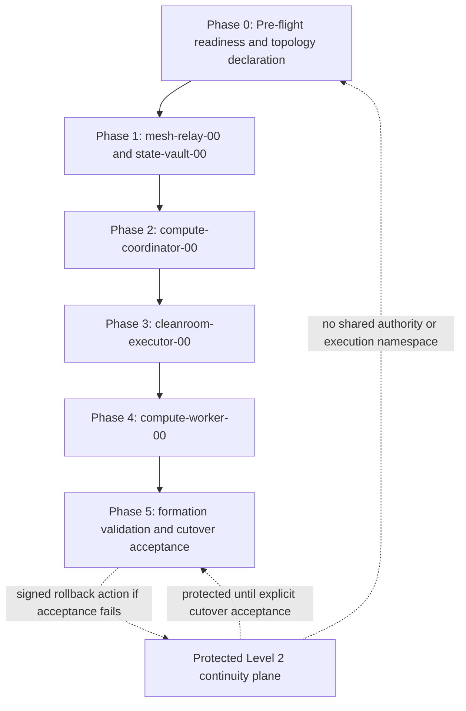

# Level 3 Staged Deployment Phase Map

**Status:** Draft specification; documentary and non-actuating

**Protocol version:** `0.1.0-draft`

**Repository baseline:** `6f3fb54047fffb5216bce9b7b9c0f0465c35c03d`

## 1. Specification frame

### 1.1 Scope, vantage, and stopping boundary

This document defines a provider-agnostic phase map for forming the Level 3 topology from declared candidates while preserving Level 2 continuity until an explicit cutover acceptance. It coordinates, but does not replace, the [distributed queue specification](LEVEL_3_DISTRIBUTED_QUEUE_SPEC.md), [network overlay specification](LEVEL_3_NETWORK_OVERLAY_SPEC.md), and [snapshot rehydration protocol](LEVEL_3_SNAPSHOT_REHYDRATION_PROTOCOL.md).

The vantage is an independent formation verifier reviewing content-addressed declarations, gate receipts, lifecycle ledgers, authority decisions, route policy, queue evidence, and observation records. Documentary source statements are not live observations. Simulations are bounded evidence about supplied models, not proof of effective live state.

This phase map stops at the ordered documentary evidence chain of successful observation, signed final formation acceptance, a later separate signed cutover/decommission decision, and optional decommission completion—or at a signed fail-closed halt. It does not provision, restore, enroll, route, activate, cut over, decommission, or inspect any live infrastructure.

### 1.2 Logical topology and `-00` origin rule

The only normative origin coordinates are:

| Logical coordinate | Exclusive role boundary |
| --- | --- |
| `compute-coordinator-00` | CAS lease, fencing-token, and terminal-lifecycle authority |
| `mesh-relay-00` | Private transport relay and signal mesh |
| `state-vault-00` | Durable ledger and effect-attestation evidence anchor |
| `cleanroom-executor-00` | Public ingress, TLS termination, and isolated verifier |
| `compute-worker-00` | Origin unit-cell container host |

The `-00` suffix is the logical genesis coordinate, not a provider name or evidence of current activation. A legacy or provider label ending in `-01` is provenance only and is not equivalent to, an alias for, or authority over any origin coordinate. No phase may infer a binding from provider naming, reachability, resemblance, local exit status, snapshot name, address, or hostname.

No wildcard, unbound coordinate, implicit future sibling, provider resource, address, or transport identity may appear as an authority-bearing phase participant. Future siblings require separate signed coordinate bindings, gate bundles, lifecycle ledgers, capability sets, and phase-map revision.

### 1.3 Authority and evidence classes

- **Documentary evidence** records prior claims or design ancestry; it is not present state.
- **Declared evidence** states intended topology, scope, dependencies, and expected bindings.
- **Produced gate evidence** is a candidate receipt not yet accepted by the applicable authority.
- **Verified evidence** has passed a named validation under an identified verifier.
- **Attested evidence** is signed, hash-bound, scoped, and linked to predecessor lineage.
- **Observed evidence** records a bounded observation, vantage, time, and configuration digest.
- **Authority decision** is a CAS-controlled admission, activation, cutover, rollback, revocation, or final-acceptance decision.
- **Diagnostic evidence** includes health and SNR observations; it may halt progression but cannot grant authority.

A phase completion receipt proves that its named prerequisites and checks were accepted under the recorded scope. It does not prove unobserved downstream effects, future health, or correctness outside that scope.

### 1.4 Normative language and versioning

The terms **MUST**, **MUST NOT**, **SHOULD**, **SHOULD NOT**, and **MAY** are normative. Major versions change identity, authority, lifecycle, gate, phase, or cutover meaning. Minor versions may add evidence without weakening existing requirements. Patch versions clarify validation only. Accepted records are immutable and content-addressed; correction creates a linked successor.

### 1.5 Assumptions, exclusions, and threat model

Assumptions:

- Canonical records can be hashed, signed, retained, and independently verified.
- Identity-binding, gate-acceptance, lifecycle, and cutover authorities support CAS or an equivalent linearizable decision.
- Consequential sinks can enforce durable fences or fail closed.
- A protected Level 2 continuity plane can remain logically and operationally disjoint from Level 3 shadow validation until cutover.

Excluded decisions and actions include provider selection, resource creation, snapshot creation or restoration, volume attachment, address assignment, overlay selection or enrollment, DNS publication, firewall application, listener activation, key generation, queue mutation, service deployment, and runtime actuation. Real addresses, credentials, provider identifiers, live node claims, and executable commands are prohibited.

Threats include duplicate coordinates, inherited keys, stale snapshots, forged or duplicated receipts, verifier/acceptor collision, wildcard ACLs, relay privilege escalation, vault authority expansion, dual active queue authorities, dual Level 2/Level 3 execution, token reuse, stale epochs, ledger gaps, blind replay, public exposure of private roles, capability omission disguised as denial, partial overlay admission, health regression after activation, and cutover without rollback evidence.

## 2. State, phase, and decision model

### 2.1 State is not phase

A **node lifecycle state** describes one coordinate's admitted identity and authority condition. A **deployment phase** groups bounded preparation, admission, activation, observation, and acceptance decisions across one or more coordinates. Phase progression MUST NOT substitute for node lifecycle progression, and phase completion MUST NOT activate a node whose lifecycle is incomplete.

The exact machine lifecycle is:

`declared → isolated_rehydration → verified → attested → admitted_to_overlay → role_activated`

The only auxiliary states are `quarantined` and `revoked`. No success transition may be skipped. `rollback` is a signed action and transition, never a lifecycle state.

### 2.2 Permitted lifecycle transitions

| Transition | Required meaning |
| --- | --- |
| `declared → isolated_rehydration` | Create a unique isolated attempt and evidence namespace. |
| `isolated_rehydration → isolated_rehydration` | Produce or accept gate evidence without granting authority. |
| `isolated_rehydration → verified` | Accept exactly one canonical receipt for every Gate `01`–`10` plus role deltas. |
| `verified → attested` | Independent verifier signs the complete evidence bundle. |
| `attested → admitted_to_overlay` | Binding authority accepts one current coordinate/identity and bounded route policy. |
| `admitted_to_overlay → role_activated` | Authoritative acceptor signs exact capability grants and explicit denials. |
| `verified`, `attested`, or `admitted_to_overlay → isolated_rehydration` | Signed rollback action proves complete removal of newly granted capabilities, routes, public exposure, leases, and effect eligibility and proves restored isolation. |
| Any non-revoked state `→ quarantined` | Missing, contradictory, ambiguous, expired, or regressed evidence halts progression. |
| Any state `→ revoked` | Compromise, invalid binding, duplicate authority, or authorized revocation permanently invalidates the attempt. |
| `role_activated → quarantined` or `role_activated → revoked` | The only legal post-activation failure destinations; containment or revocation removes authority and preserves evidence. |

Every other pair is illegal. In particular, `role_activated → isolated_rehydration` is prohibited. A failure after `role_activated` MUST transition to `quarantined` or `revoked`; re-entry requires a fresh successor attempt beginning through the full lifecycle with new identity, lineage, Gate `01`–`10`, and activation evidence. Partial overlay admission that cannot be completely removed MUST end in `quarantined` or `revoked`. Semantic transition validation MUST inspect both prior state and requested destination; a destination enum alone is insufficient.

### 2.3 Canonical Gate `01`–`10` registry

| Index | Canonical gate name | Settled purpose |
| --- | --- | --- |
| `01` | `snapshot-provenance-integrity-proof` | Identify supplied bytes and custody without inferring authority. |
| `02` | `logical-00-coordinate-binding` | Bind one exact logical coordinate across identity namespaces. |
| `03` | `provider-instance-overlay-key-replacement` | Retire inherited identities and bind fresh public identity evidence. |
| `04` | `genesis-formation-identity-verification` | Verify formation/genesis lineage and governing baseline. |
| `05` | `boot-identity-stale-instance-exclusion` | Bind fresh boot identity and exclude predecessors. |
| `06` | `durable-volume-ledger-reconstruction` | Reconstruct durable state from accepted evidence. |
| `07` | `queue-receipt-gap-classification-reconciliation` | Classify gaps and prohibit blind replay. |
| `08` | `high-water-register-restoration-fencing-epoch-advancement` | Prove exclusive authority and monotonic token/fence lineage. |
| `09` | `network-acl-public-exposure-verification` | Prove exact routes, default deny, and public-exposure boundary. |
| `10` | `signed-activation-attestation-rollback-evidence` | Bind all accepted evidence into activation and rollback decisions. |

Receipt production and receipt acceptance are distinct. A phase MAY produce gate evidence incrementally, but a coordinate MUST have exactly one accepted receipt for each canonical index/name pair before `role_activated`. Missing, extra, rejected, duplicate-semantic, or index/name-mismatched receipts fail closed.

### 2.4 Verifier, acceptor, and capability invariants

For every consequential gate, lifecycle, phase, cutover, rollback, revocation, and final-acceptance decision, `verifier_id != acceptor_id`. Verifier and acceptor signatures MUST be separately keyed and bind signer identity, signer role, canonical payload digest, and predecessor lineage.

Every activation decision MUST carry immutable, canonical, unique, role-delta-validated `granted_capabilities` and `denied_capabilities` arrays. The arrays MUST be mutually disjoint and signature-bound. Explicit denial proves exclusion; omission does not. Missing, overlapping, contradictory, mutable, unbound, or role-inconsistent arrays fail closed.

## 3. Dependency DAG and phase matrix

### 3.1 Dependency DAG



The DAG defines readiness order, not ambient trust. `mesh-relay-00` grants no transitive trust. `state-vault-00` supplies evidence, not lifecycle authority. No later phase may retroactively validate an earlier unsafe activation.

### 3.2 Phase matrix

| Phase | Included coordinates | Hard dependency | Maximum phase outcome | Prohibited inference |
| --- | --- | --- | --- | --- |
| 0 | All five as declarations only | Governing specs and clean evidence baseline | Signed topology/readiness declaration | Declared means provisioned or reachable |
| 1 | `mesh-relay-00`, `state-vault-00` | Phase 0 accepted | Both roles activated under narrow capabilities after full gates | Relay reachability or stored bytes imply trust/authority |
| 2 | `compute-coordinator-00` | Phase 1 evidence paths accepted | Sole CAS/fencing/terminal authority activated | Reachability or recovered files imply exclusivity |
| 3 | `cleanroom-executor-00` | Phase 2 authority active and bounded | Cleanroom activated; public listeners remain cutover-controlled | TLS or listener success implies private authority |
| 4 | `compute-worker-00` | Phase 2 authority and Phase 1 evidence anchor available; Phase 3 boundary accepted | Worker activated for bounded shadow/no-authority validation | Local completion implies committed effect |
| 5 | All five | Phases 0–4 accepted and observation evidence complete | Signed formation acceptance and optional Level 3 cutover | Phase receipts alone prove downstream effects |

“No partial formation activation” means no phase completion may represent the five-role formation as accepted before Phase 5. Individual roles may reach `role_activated` only within their phase, with production traffic, queue execution, and public ingress still constrained by cutover policy.

## 4. Per-node lifecycle ledger

The formation MUST maintain one immutable ledger chain per coordinate and one cross-coordinate phase ledger. Each node entry MUST bind phase, prior and next lifecycle state, Gate `01`–`10` map digest, role/authority/policy/key epochs, binding digest, exact grant/deny sets, verifier and acceptor identities, observation window, rollback anchor, and predecessor digest.

| Coordinate | Declared in | Gate production/acceptance phase | Earliest activation phase | Phase 5 revalidation |
| --- | --- | --- | --- | --- |
| `mesh-relay-00` | 0 | 1 | 1 | Relay isolation, no-transit, loss, and key-rotation evidence |
| `state-vault-00` | 0 | 1 | 1 | Ledger integrity, proof queries, and no-CAS/no-terminal-authority evidence |
| `compute-coordinator-00` | 0 | 2 | 2 | Exclusive authority, epoch, high-water, token, and partition evidence |
| `cleanroom-executor-00` | 0 | 3 | 3 | Cleanroom-only public exposure and private-boundary evidence |
| `compute-worker-00` | 0 | 4 | 4 | Bounded execution, fence, idempotency, replay, and sink evidence |

Phase 5 revalidation references accepted receipts by digest; it MUST NOT create a second accepted receipt for the same coordinate/gate/attempt.

## 5. Phase requirements

### Phase 0 — Pre-flight Readiness & Topology Declaration

- **Objective:** Establish a signed, non-actuating topology declaration, evidence namespace, phase DAG, role boundaries, Level 2 continuity boundary, and rollback anchors.
- **Included coordinates:** `compute-coordinator-00`, `mesh-relay-00`, `state-vault-00`, `cleanroom-executor-00`, and `compute-worker-00`, all in `declared` only.
- **Prerequisites/dependencies:** Matching governing-spec digests; formation/genesis reference; canonical gate registry; coordinate inventory; authority-role registry; protected Level 2 continuity declaration; no shared Level 2/Level 3 task namespace.
- **Permitted lifecycle transitions:** No activation transition. A uniquely accepted recovery case MAY move a candidate `declared → isolated_rehydration` only after its later owning phase begins.
- **Gate receipts:** No Gate `01`–`10` receipt is accepted as activation evidence in Phase 0. The phase declaration MUST allocate exactly one planned gate slot per index for each coordinate and name the future producer, verifier, acceptor, and owning phase.
- **Other input evidence:** Specification baselines, role/capability policy, dependency graph, lifecycle policy, cutover policy, evidence-retention policy, and provider-neutral rollback destinations.
- **Independent verifier:** Formation-readiness verifier, distinct from every later phase acceptor.
- **Authoritative acceptor:** Formation topology-declaration authority.
- **Granted/denied capabilities:** Grants are evidence submission and isolated inspection only. All queue CAS, fencing, terminal lifecycle, relay transit, ledger mutation, workload execution, production routes, public ingress, and cutover capabilities are explicitly denied.
- **Success postconditions:** One signed declaration binds the five exact coordinates, six phases, gate registry, Level 2 boundary, verifier/acceptor separation, and no-wildcard policy. No role is represented as active.
- **Health/observation window:** A configured documentary consistency window verifies stable digests, signer validity, no duplicate declarations, and no policy drift. It is diagnostic, not authority.
- **Fail-closed halt:** Missing baseline, duplicate coordinate, wildcard authority, unresolved signer collision, contradictory role policy, or shared execution namespace halts at `declared` or moves the affected attempt to `quarantined`.
- **Rollback action/anchor:** Signed declaration withdrawal references the predecessor formation baseline, revokes declaration-derived eligibility, and removes no runtime state because none was authorized.
- **Next-phase handoff:** Content-addressed Phase 0 completion receipt plus the isolated-attempt authorization for `mesh-relay-00` and `state-vault-00`.

### Phase 1 — Core Mesh Transport & Durable State Anchor Provisioning

- **Objective:** Admit the private relay and durable evidence anchor without granting transitive trust or queue authority.
- **Included coordinates:** `mesh-relay-00` and `state-vault-00`.
- **Prerequisites/dependencies:** Accepted Phase 0 declaration; isolated candidates; fresh identity plan; exact route/service-class policy; vault provenance and ledger anchors; Level 2 remains protected and authoritative for its own disjoint namespace.
- **Permitted lifecycle transitions:** For each included coordinate, the complete sequence from `declared` through `role_activated`, with no skip and with legal quarantine/revocation/rollback edges only.
- **Gate receipts:** Each coordinate produces and accepts exactly one receipt for Gate `01`–`10`. Gates `01`–`09` are produced during isolation and acceptance review; Gate `10` may be accepted only after the first nine, role deltas, and lifecycle evidence pass. Relay Gate `09` proves no wildcard transit; vault Gates `06`–`08` prove evidence integrity and explicit absence of queue authority.
- **Other input evidence:** Relay endpoint-authentication and no-transitive-trust proofs; vault volume/ledger reconstruction, proof-query, append-authentication, and no-lifecycle-CAS proofs; negative route tests; key-replacement and revocation evidence.
- **Independent verifier:** Separate relay-policy and vault-ledger verifiers, each distinct from the Phase 1 acceptor.
- **Authoritative acceptor:** Formation role-activation authority, with identity-binding authority separately accepting coordinate bindings.
- **Granted/denied capabilities:** Relay grants only authenticated relay/signal service classes and denies queue CAS, evidence signing, general subnet transit, unrestricted exit, and policy minting. Vault grants authenticated evidence recording and proof query and denies queue CAS, lease/token issuance, lifecycle advancement, terminal decisions, and public ingress.
- **Success postconditions:** Both gate maps are complete; bindings and epochs are current; relay cannot broaden trust; vault remains evidence-only; only exact predeclared private flows are eligible; Level 2 remains unchanged.
- **Health/observation window:** A configured bounded window observes ledger append/proof integrity, deny behavior, relay metadata isolation, route stability, key status, and absence of authority mutation. SNR is diagnostic only.
- **Fail-closed halt:** Ledger gap, signature mismatch, duplicate/missing gate, relay wildcard, transit bypass, vault CAS capability, stale key, ACL drift, or verifier/acceptor collision causes halt and `quarantined` or `revoked` disposition.
- **Rollback action/anchor:** Before activation, a signed action from `verified`, `attested`, or `admitted_to_overlay` MAY return to `isolated_rehydration` only after complete capability/route removal and isolation proof. Any failure after `role_activated` MUST remove relay/vault capabilities and routes, retain ledger and contradiction evidence, and transition only to `quarantined` or `revoked`; re-entry requires a fresh successor attempt through the full lifecycle.
- **Next-phase handoff:** Signed Phase 1 completion receipt binds relay and vault Gate `01`–`10` maps, capability exclusions, observation evidence, and the vault evidence coordinate required by coordinator recovery.

### Phase 2 — Authority Fencing & Queue Coordinator Rehydration

- **Objective:** Establish `compute-coordinator-00` as the sole Level 3 CAS lease, fencing-token, and terminal-lifecycle authority only after exclusivity and monotonic lineage are proved.
- **Included coordinates:** `compute-coordinator-00`.
- **Prerequisites/dependencies:** Accepted Phase 1; authenticated evidence path to `state-vault-00`; transport path that does not confer trust; queue authority and protected-sink inventories; Level 2 namespace remains disjoint and not dual active.
- **Permitted lifecycle transitions:** Complete exact lifecycle for the coordinator, including authority-epoch advancement before admission when continuity or exclusivity is uncertain.
- **Gate receipts:** Exactly one accepted Gate `01`–`10` receipt. Gates `06`–`08` MUST reconstruct accepted receipts, classify every gap, restore queue/task and sink high-water registers, invalidate prior renewals, prove stale-authority exclusion, and bind the first new token above every predecessor high-water mark. Gate `10` cannot activate before one exclusive authority and one token sequence are proved.
- **Other input evidence:** Queue authority substrate proof; monotonic-clock continuity or recovery-wait proof; idempotency slot/tombstone inventory; claim and sink-fence lineage; effect-attestation and reconciliation records; protected-sink enforcement evidence.
- **Independent verifier:** Queue/fencing recovery verifier with no coordinator activation authority.
- **Authoritative acceptor:** Queue authority-lineage acceptor for epoch/exclusivity plus formation role-activation authority for activation; each distinct from the verifier.
- **Granted/denied capabilities:** Grants queue CAS, lease allocation/renewal, monotonic token allocation, fencing, reconciliation authorization within policy, and terminal lifecycle CAS. Denies public ingress, relay policy minting, vault-side truth mutation, worker execution, and authority over the Level 2 namespace.
- **Success postconditions:** One coordinator binding is current; no predecessor can renew, advance registers, or reach protected sinks; all high-water values are durable; token/fence non-reuse is proved; queue actuation remains shadow/no-authority until its explicit cutover scope is accepted.
- **Health/observation window:** A configured bounded window observes CAS uniqueness, token monotonicity, stale-writer rejection, vault receipt integrity, partition response, and authority availability without allowing SNR to override safety.
- **Fail-closed halt:** Authority ambiguity, stale epoch/token, register gap, unqueryable effect, duplicate authority, clock discontinuity without accepted recovery proof, signature collision, or sink unable to fence freezes claims, renewals, takeovers, CAS, and consequential writes.
- **Rollback action/anchor:** Before activation, a signed action from `verified`, `attested`, or `admitted_to_overlay` MAY return to `isolated_rehydration` only after complete authority, renewal, sink-access, route, and capability removal plus isolation proof. Any failure after `role_activated` MUST revoke coordinator authority, freeze claims/CAS/effects, preserve queue/register contradictions, and transition only to `quarantined` or `revoked`; re-entry requires a fresh successor attempt through the full lifecycle.
- **Next-phase handoff:** Signed Phase 2 completion receipt binds exclusive authority, epochs, high-water manifest, Gate map, capability sets, observation window, and private service classes available to the cleanroom.

### Phase 3 — Public Ingress & Cleanroom Verification Provisioning

- **Objective:** Admit `cleanroom-executor-00` as the sole public-ingress/TLS and isolated-verifier role while keeping public listeners closed until the authorized exposure transition.
- **Included coordinates:** `cleanroom-executor-00`.
- **Prerequisites/dependencies:** Accepted Phase 2 coordinator authority; accepted Phase 1 evidence and relay boundaries; exact ingress identity and private-upstream policy; no public route to any private role.
- **Permitted lifecycle transitions:** Complete exact lifecycle. Public TCP `80`/`443` remains denied through `attested`; overlay admission permits only bounded private validation; public exposure requires accepted `role_activated` capability and remains cutover-controlled.
- **Gate receipts:** Exactly one accepted Gate `01`–`10` receipt. Gate `09` MUST prove cleanroom-only public exposure intent, exact private upstreams, header normalization, default deny, and negative reachability to authority storage, vault management, worker administration, and relay policy control. Gate `10` binds public exposure capability and all denials.
- **Other input evidence:** Certificate provenance, TLS identity, request-boundary policy, listener intent, public and private route digests, upstream authentication, rate/size limits, and rollback policy.
- **Independent verifier:** Ingress/exposure verifier distinct from the public-exposure and role-activation acceptors.
- **Authoritative acceptor:** Overlay admission authority plus formation role-activation authority; public exposure additionally requires the cutover authority's bounded authorization.
- **Granted/denied capabilities:** Grants isolated verification, TLS termination, and public TCP `80`/`443` only under accepted exposure policy. Denies queue CAS, lease/fence issuance, direct authority storage, vault management, worker administration, general forwarding, and conversion of public claims into private principals.
- **Success postconditions:** Gate map and binding are complete; only cleanroom public exposure is eligible; all private roles default-drop unsolicited public ingress; cleanroom cannot bypass coordinator acceptance or write unfenced effects.
- **Health/observation window:** A configured bounded window observes certificate validity, listener parity, negative routes, private-upstream authentication, request normalization, and absence of private-role public exposure.
- **Fail-closed halt:** Unexpected public listener, ACL drift, certificate/signature mismatch, private-route loss, wildcard upstream, authority bypass, missing gate, or health regression closes public exposure and halts progression.
- **Rollback action/anchor:** Before activation, a signed action from `verified`, `attested`, or `admitted_to_overlay` MAY return to `isolated_rehydration` only after complete listener, route, exposure, and capability removal plus isolation proof. Any failure after `role_activated` MUST close public exposure, remove private routes, retain exposure-window evidence, and transition only to `quarantined` or `revoked`; re-entry requires a fresh successor attempt through the full lifecycle.
- **Next-phase handoff:** Signed Phase 3 completion receipt binds Gate map, cleanroom-only exposure policy, negative reachability evidence, exact capability sets, and worker-phase private validation boundary.

### Phase 4 — Compute Worker Unit-Cell Host Admission

- **Objective:** Admit `compute-worker-00` for bounded execution only under current authority, fence, identity, capability, idempotency, and replay controls.
- **Included coordinates:** `compute-worker-00`.
- **Prerequisites/dependencies:** Accepted Phase 2 authority; Phase 1 vault evidence path; Phase 3 boundary accepted where ingress-originated work is tested; approved adapters and protected-resource scopes; Level 2 execution remains separate.
- **Permitted lifecycle transitions:** Complete exact lifecycle. Before formation cutover, activated worker behavior is limited to shadow/no-authority validation that cannot claim Level 2 work or produce production effects.
- **Gate receipts:** Exactly one accepted Gate `01`–`10` receipt. Gates `07`–`08` MUST prove idempotency-slot binding, current claim/lease/fence/epoch checks, effect-attempt evidence, deterministic replay classification, and stale-writer rejection. Gate `10` binds only allowlisted execution capabilities and explicit denials.
- **Other input evidence:** Workload identity, boot binding, mount/configuration digest, adapter classification, sink proof-query contract, replay policy, queue partition, task namespace, effect-attestation path, and negative authority tests.
- **Independent verifier:** Worker execution/fencing verifier independent of worker and activation acceptor.
- **Authoritative acceptor:** Formation role-activation authority; coordinator remains the only queue lifecycle acceptor.
- **Granted/denied capabilities:** Grants bounded claim proposal, heartbeat, allowlisted execution, result/effect proposal, and authenticated evidence submission under current fences. Denies queue CAS, token allocation, terminal decisions, direct high-water mutation, public ingress, relay transit expansion, vault management, and unfenced effects.
- **Success postconditions:** Worker cannot execute without current authority and sink fences; duplicate delivery is idempotent; terminal receipts suppress replay; ambiguous effects halt; shadow validation cannot mutate Level 2 or production Level 3 state.
- **Health/observation window:** A configured bounded window observes claim/fence checks, duplicate delivery, crash boundaries, effect attestations, replay suppression, stale-token rejection, and worker isolation. Local command success is not completion evidence.
- **Fail-closed halt:** Stale token/epoch, missing capability, idempotency conflict, ambiguous effect, ledger gap, replay uncertainty, unfenced sink, duplicate receipt, or authority loss stops execution and preserves evidence.
- **Rollback action/anchor:** Before activation, a signed action from `verified`, `attested`, or `admitted_to_overlay` MAY return to `isolated_rehydration` only after complete worker-route, execution-capability, claim, and sink-eligibility removal plus isolation proof. Any failure after `role_activated` MUST revoke execution eligibility, retain checkpoints as non-authoritative evidence, and transition only to `quarantined` or `revoked`; re-entry requires a fresh successor attempt through the full lifecycle.
- **Next-phase handoff:** Signed Phase 4 completion receipt binds the worker Gate map, exact adapters/capabilities, queue and sink-fence evidence, observation results, and proof that no production cutover has been inferred.

### Phase 5 — End-to-End Formation Health & Attestation Validation

- **Objective:** Revalidate the five-role formation, exercise failure boundaries, conduct bounded Level 3 observation while Level 2 recovery authority remains protected, issue or deny signed final formation acceptance, and only afterward decide decommission through a separate signed cutover/decommission decision.
- **Included coordinates:** All five exact origin coordinates.
- **Prerequisites/dependencies:** Accepted Phase 0–4 receipts; one complete accepted Gate `01`–`10` map per coordinate; stable lifecycle ledgers; protected and independently recoverable Level 2 authority; no shared active execution namespace.
- **Permitted lifecycle transitions:** No lifecycle skip or collective activation. Existing `role_activated` states are revalidated by digest. Any post-activation regression transitions the affected coordinate only to `quarantined` or `revoked`; re-entry requires a fresh successor attempt through the full lifecycle. Final formation acceptance and cutover/decommission are formation decisions, not node states.
- **Gate receipts:** Phase 5 MUST verify, not duplicate, exactly fifty accepted coordinate/gate entries: ten canonical receipts for each of five coordinates. It MUST verify coordinate/index/name/digest/accepted-decision correspondence, acceptance evidence, distinct signers, predecessor lineage, role deltas, and activation capability arrays. Missing, extra, duplicate-semantic, mismatched, or rejected entries deny acceptance.
- **Other input evidence:** Single authority/token sequence; vault integrity; relay isolation; cleanroom-only public exposure; worker bounded execution; route/ACL parity; queue idempotency, fencing, crash, effect-attestation, and replay evidence; partition, relay-loss, key-rotation, and rehydration exercises; Level 2 independent recovery and rollback viability; health/SNR observations; final-acceptance and separate cutover/decommission evidence.
- **Independent verifier:** Formation acceptance verifier independent of every phase acceptor and candidate role. The later cutover/decommission decision also requires its own independent verifier, distinct from its acceptor.
- **Authoritative acceptor:** Formation final-acceptance authority for acceptance, followed only after successful observation and acceptance by a separate cutover/decommission authority decision. Neither may override gate or lifecycle failures, and final acceptance alone MUST NOT authorize Level 2 decommission.
- **Granted/denied capabilities:** Final acceptance binds the union of all role-specific grant/deny sets without creating transitive grants. It denies undeclared coordinates, wildcard authority, dual active authority, dual execution, vault lifecycle authority, relay ambient trust, private-role public ingress, worker terminal authority, and premature Level 2 decommission.
- **Success postconditions:** The complete observation window succeeds; one Level 3 authority and monotonic token sequence are proved; vault evidence is intact and non-authoritative; relay remains isolated; only cleanroom is publicly eligible; worker effects remain fenced; route/ACL intent matches observations; fault exercises pass; Level 2 remains retained, protected, independently recoverable, and rollback-viable through the observation and final-acceptance boundary; signed final formation acceptance is accepted; and a later, separately signed cutover/decommission decision explicitly authorizes or denies Level 2 authority decommission.
- **Health/observation window:** A configured formation-wide window begins only after bounded Level 3 activation and all verification exercises. During the entire window Level 2 authority remains retained, protected, independently recoverable, and non-actuating as required to prevent dual authority or execution. Health/SNR may block acceptance but cannot authorize it. Simulation results remain labeled simulation. Rollback viability MUST remain valid through completion of the window and final-acceptance decision.
- **Fail-closed halt:** Incomplete, failed, contradictory, or regressed health evidence; missing or invalid final-acceptance or cutover/decommission evidence; gate/signature mismatch; duplicate/missing receipt; authority ambiguity; token regression; ledger gap; ACL drift; public exposure violation; exercise failure; rollback failure; or signer collision leaves both planes non-actuating and retains Level 2 recovery authority. No dual execution or dual CAS authority is permitted.
- **Rollback action/anchor:** Revoke newly granted Level 3 cutover capabilities, close public exposure, stop worker execution, freeze coordinator claims/CAS as required, remove admitted routes, preserve all evidence, and retain or restore protected Level 2 only after proving no dual authority/execution. Any failure after a Level 3 coordinate is `role_activated` transitions it only to `quarantined` or `revoked`; re-entry requires a fresh successor attempt. Level 2 decommission is forbidden until the complete window, accepted final formation acceptance, and separate accepted cutover/decommission decision all exist.
- **Next-phase handoff:** None. The terminal evidence chain is ordered: successful observation receipt → signed final formation acceptance → separate signed cutover/decommission decision → optional Level 2 authority decommission evidence. Any missing or rejected link yields signed halt/rollback/revocation evidence with Level 2 recovery authority retained.

## 6. Gate integration matrix

`P` means gate evidence is produced; `A` means the one canonical receipt is accepted for that coordinate; `V` means Phase 5 verifies an existing accepted receipt by digest without re-accepting it.

| Coordinate / owning phase | 01 | 02 | 03 | 04 | 05 | 06 | 07 | 08 | 09 | 10 |
| --- | --- | --- | --- | --- | --- | --- | --- | --- | --- | --- |
| `mesh-relay-00` / Phase 1 | P/A | P/A | P/A | P/A | P/A | P/A | P/A | P/A | P/A | P/A |
| `state-vault-00` / Phase 1 | P/A | P/A | P/A | P/A | P/A | P/A | P/A | P/A | P/A | P/A |
| `compute-coordinator-00` / Phase 2 | P/A | P/A | P/A | P/A | P/A | P/A | P/A | P/A | P/A | P/A |
| `cleanroom-executor-00` / Phase 3 | P/A | P/A | P/A | P/A | P/A | P/A | P/A | P/A | P/A | P/A |
| `compute-worker-00` / Phase 4 | P/A | P/A | P/A | P/A | P/A | P/A | P/A | P/A | P/A | P/A |
| Formation / Phase 5 | V | V | V | V | V | V | V | V | V | V |

Phase 0 allocates planned slots only and does not appear as receipt production or acceptance. Gate acceptance occurs exactly once per coordinate/attempt. Phase 5 rejects any map that does not contain exactly the canonical fifty coordinate/gate bindings.

## 7. Role and capability matrix

| Coordinate | Required grants after activation | Mandatory explicit denials |
| --- | --- | --- |
| `compute-coordinator-00` | Queue CAS, lease/renewal, monotonic token allocation, fencing, terminal lifecycle CAS, policy-bounded reconciliation | Public ingress, worker execution, relay transit expansion, vault-side truth substitution, Level 2 authority |
| `mesh-relay-00` | Authenticated relay and signal service classes only | Queue/ledger authority, endpoint impersonation, general transit, unrestricted exit, ACL minting, public application ingress |
| `state-vault-00` | Authenticated evidence append, retention, proof query, signed evidence receipt | Queue CAS, lease/token allocation, lifecycle advancement, terminal decisions, public ingress |
| `cleanroom-executor-00` | Isolated verification, TLS termination, bounded public TCP `80`/`443` under cutover policy | Queue authority, direct authority storage, vault management, worker administration, general forwarding, public-claim elevation |
| `compute-worker-00` | Claim/heartbeat proposal, allowlisted fenced execution, result/effect proposal, evidence submission | Queue CAS, token allocation, terminal decision, register mutation, public ingress, unfenced effect, authority bypass |

Capability arrays are closed-world for the evaluated role policy: every evaluated capability is present in exactly one of the grant or deny arrays.

## 8. Level 2 continuity and cutover

Level 2 is a protected continuity plane based on documentary single-host semantics. This map makes no claim of a presently deployed or active Level 2 instance. If an operator designates a conforming Level 2 instance as the continuity plane, its authority MUST remain retained, protected, independently recoverable, and not decommissioned or revoked until the complete formation-wide health observation window succeeds, signed final formation acceptance is accepted, and a later separate signed cutover/decommission decision explicitly authorizes decommission.

### 8.1 Coexistence and shadow validation

- Level 2 and Level 3 MUST use disjoint task, idempotency, claim, result, receipt, effect, and authority namespaces before cutover.
- Level 3 shadow validation MAY replay sanitized or synthetic inputs only into non-consequential, independently identified sinks.
- Shadow results are diagnostic proposals; they MUST NOT acknowledge, commit, cancel, or mutate Level 2 work.
- Level 2 MUST NOT consume Level 3 claims or tokens, and Level 3 MUST NOT infer authority from Level 2 files, timers, cursors, or local locks.
- At no time may both planes execute the same production work or hold CAS authority over the same queue partition or protected resource.
- During bounded Level 3 activation and observation, Level 2 MAY be non-actuating behind a signed cutover barrier but MUST remain protected and independently recoverable. Non-actuating is not decommissioned or revoked.
- Rollback viability MUST remain verified through the entire observation window and final-acceptance boundary.

### 8.2 Cutover matrix

| Ordered cutover stage | Level 2 posture | Level 3 posture | Required accepted evidence | Failure disposition |
| --- | --- | --- | --- | --- |
| Preparation and shadow validation | Retained, protected, recoverable, and sole production authority if designated | Declared/isolated or non-consequential shadow only | Namespace/sink separation, synthetic parity, fencing, ACL, and replay evidence | Any overlap or shadow mutation halts |
| Cutover barrier and quiescence | Retained and recoverable; stop new production claims only under signed barrier | Claims and production effects remain frozen | Queue drain/ambiguity register, high-water and sink-fence proofs, rollback anchor | Unknown effect or authority ambiguity leaves both non-actuating |
| Bounded Level 3 activation and observation | Protected, independently recoverable, and non-actuating; not decommissioned or revoked | Sole bounded active authority/execution within accepted scope | Stale-Level-2 exclusion, Level 3 epoch/token proof, complete health-window observations | Regression freezes Level 3 and retains Level 2 recovery authority |
| Final formation acceptance | Still protected, recoverable, and non-actuating | Continues only within accepted bounded scope | Complete 50-receipt map, successful observation, rollback viability, separately signed final acceptance | Missing, failed, or contradictory evidence leaves both non-actuating |
| Separate cutover/decommission decision | Still retained until this later decision is accepted | No authority expansion from final acceptance alone | Decision binds accepted final-acceptance digest, observation digest, predecessor, distinct verifier/acceptor, and signatures | Missing or invalid decision forbids decommission |
| Level 2 authority decommission | Decommission only after all preceding evidence is accepted; preserve audit/recovery evidence as policy requires | Sole accepted production plane | Signed decommission completion receipt and no-dual-authority proof | Incomplete decommission evidence fails closed |
| Rollback to Level 2 before decommission | Re-entry only after Level 3 authority/execution removal and a new signed barrier | Frozen, routes/capabilities removed | Reconciled effects, no-dual-authority proof, restored Level 2 eligibility | Ambiguity keeps both non-actuating |

Final formation acceptance MUST NOT itself authorize Level 2 authority decommission. The separate cutover/decommission decision follows successful observation and accepted final formation acceptance. If health validation is incomplete, failed, contradictory, or either evidence link is missing or invalid, both planes remain non-actuating and Level 2 recovery authority remains retained. No dual execution or dual CAS authority is permitted.

## 9. Rollback and fail-closed matrix

| Trigger | Immediate halt | Required signed action | Legal destination |
| --- | --- | --- | --- |
| Gate failure, missing/duplicate receipt, or signature mismatch before activation | Stop phase admission and activation | Preserve conflict; revoke eligibility; prove complete removal and isolation | `isolated_rehydration` only from `verified`, `attested`, or `admitted_to_overlay`; otherwise `quarantined` |
| Verifier/acceptor collision | Reject decision and all dependent receipts | Issue invalid-decision and successor-lineage evidence | `quarantined` |
| Stale epoch/token or authority ambiguity | Freeze claims, renewals, CAS, and effects | Revoke authority binding; reconcile high-water and sink registers | `quarantined` or `revoked` |
| Ledger gap or contradictory effect evidence | Stop terminal receipt and replay | Classify gap; retain contradictions; authorize only side-effect-free proof queries | `quarantined` |
| ACL drift, wildcard route, or relay transit expansion before activation | Remove affected routes and forwarding | Restore known-safe default-deny policy without reviving revoked identity; prove isolation | `isolated_rehydration` only from `verified`, `attested`, or `admitted_to_overlay`; otherwise `quarantined` or `revoked` |
| Unexpected public exposure | Close exposure and dependent private routes | Bind exposure window and affected evidence | `quarantined` or `revoked` |
| Any failure after `role_activated`, including health regression | Freeze next phase/final acceptance and remove affected authority, routes, or execution | Bind observation evidence; preserve lineage; require fresh successor attempt for re-entry | `quarantined` or `revoked`; never `isolated_rehydration` |
| Partial overlay admission before activation | Remove all newly admitted routes/capabilities | Prove complete removal, isolation, and predecessor restoration | `isolated_rehydration`; otherwise `quarantined` or `revoked` |
| Cutover failure, incomplete observation, missing acceptance/decommission evidence, or dual execution risk | Stop both claim paths; preserve in-flight evidence; retain Level 2 recovery authority | Reconcile effects and prove one surviving authority before resume | Both non-actuating until signed acceptance; Level 2 remains protected and recoverable |

Every rollback action MUST bind the withdrawn receipt, reason codes, evidence digests, predecessor lineage, removed capabilities, removed routes/public exposure, resulting-state proof, verifier/acceptor identities, signatures, and rollback anchor. Contradictory evidence is never deleted.

## 10. Non-authoritative JSON schema fragments and examples

These fragments are illustrative Draft 2020-12 validation surfaces. They do not select canonical JSON, signing, storage, or authority substrates. Cross-field inequality, cryptographic validation, capability completeness/disjointness, legal transition pairs, and gate receipt authenticity require semantic validation in addition to JSON Schema.

### 10.1 Phase declaration schema fragment

```json
{
  "$schema": "https://json-schema.org/draft/2020-12/schema",
  "$id": "urn:recursive-field:schema:level-3-phase-declaration:0.1.0",
  "type": "object",
  "additionalProperties": false,
  "required": [
    "schema_name",
    "protocol_version",
    "phase_index",
    "phase_name",
    "coordinates",
    "lifecycle",
    "predecessor_sha256",
    "verifier_id",
    "acceptor_id",
    "declaration_sha256"
  ],
  "properties": {
    "schema_name": {"const": "recursive-field.level-3-phase-declaration"},
    "protocol_version": {"const": "0.1.0-draft"},
    "phase_index": {"type": "integer", "minimum": 0, "maximum": 5},
    "phase_name": {"type": "string", "minLength": 1},
    "coordinates": {
      "type": "array",
      "minItems": 1,
      "uniqueItems": true,
      "items": {
        "enum": [
          "compute-coordinator-00",
          "mesh-relay-00",
          "state-vault-00",
          "cleanroom-executor-00",
          "compute-worker-00"
        ]
      }
    },
    "lifecycle": {
      "const": [
        "declared",
        "isolated_rehydration",
        "verified",
        "attested",
        "admitted_to_overlay",
        "role_activated"
      ]
    },
    "predecessor_sha256": {"type": ["string", "null"], "pattern": "^[0-9a-f]{64}$"},
    "verifier_id": {"type": "string", "minLength": 1},
    "acceptor_id": {"type": "string", "minLength": 1},
    "declaration_sha256": {"type": "string", "pattern": "^[0-9a-f]{64}$"}
  }
}
```

### 10.2 Phase declaration example

```json
{
  "schema_name": "recursive-field.level-3-phase-declaration",
  "protocol_version": "0.1.0-draft",
  "phase_index": 2,
  "phase_name": "authority-fencing-and-queue-coordinator-rehydration",
  "coordinates": ["compute-coordinator-00"],
  "lifecycle": [
    "declared",
    "isolated_rehydration",
    "verified",
    "attested",
    "admitted_to_overlay",
    "role_activated"
  ],
  "predecessor_sha256": "1111111111111111111111111111111111111111111111111111111111111111",
  "verifier_id": "queue-recovery-verifier-example",
  "acceptor_id": "formation-phase-acceptor-example",
  "declaration_sha256": "2222222222222222222222222222222222222222222222222222222222222222"
}
```

### 10.3 Phase completion or rollback receipt schema fragment

```json
{
  "$schema": "https://json-schema.org/draft/2020-12/schema",
  "$id": "urn:recursive-field:schema:level-3-phase-receipt:0.1.0",
  "type": "object",
  "additionalProperties": false,
  "required": [
    "schema_name",
    "phase_index",
    "decision",
    "coordinate",
    "prior_state",
    "next_state",
    "gate_bundle_sha256",
    "granted_capabilities",
    "denied_capabilities",
    "removed_capabilities",
    "removed_routes",
    "rollback_anchor_sha256",
    "predecessor_sha256",
    "verifier_id",
    "verifier_signature_ref",
    "acceptor_id",
    "acceptor_signature_ref",
    "receipt_sha256"
  ],
  "properties": {
    "schema_name": {
      "const": "recursive-field.level-3-phase-receipt"
    },
    "phase_index": {
      "type": "integer",
      "minimum": 0,
      "maximum": 5
    },
    "decision": {
      "enum": [
        "complete",
        "halt",
        "rollback",
        "revoke"
      ]
    },
    "coordinate": {
      "enum": [
        "compute-coordinator-00",
        "mesh-relay-00",
        "state-vault-00",
        "cleanroom-executor-00",
        "compute-worker-00"
      ]
    },
    "prior_state": {
      "enum": [
        "declared",
        "isolated_rehydration",
        "verified",
        "attested",
        "admitted_to_overlay",
        "role_activated",
        "quarantined",
        "revoked"
      ]
    },
    "next_state": {
      "enum": [
        "declared",
        "isolated_rehydration",
        "verified",
        "attested",
        "admitted_to_overlay",
        "role_activated",
        "quarantined",
        "revoked"
      ]
    },
    "gate_bundle_sha256": {
      "type": "string",
      "pattern": "^[0-9a-f]{64}$"
    },
    "granted_capabilities": {
      "type": "array",
      "uniqueItems": true,
      "items": {
        "type": "string",
        "minLength": 1
      }
    },
    "denied_capabilities": {
      "type": "array",
      "uniqueItems": true,
      "items": {
        "type": "string",
        "minLength": 1
      }
    },
    "removed_capabilities": {
      "type": "array",
      "uniqueItems": true,
      "items": {
        "type": "string",
        "minLength": 1
      }
    },
    "removed_routes": {
      "type": "array",
      "uniqueItems": true,
      "items": {
        "type": "string",
        "minLength": 1
      }
    },
    "rollback_anchor_sha256": {
      "type": "string",
      "pattern": "^[0-9a-f]{64}$"
    },
    "predecessor_sha256": {
      "type": "string",
      "pattern": "^[0-9a-f]{64}$"
    },
    "verifier_id": {
      "type": "string",
      "minLength": 1
    },
    "verifier_signature_ref": {
      "type": "string",
      "minLength": 1
    },
    "acceptor_id": {
      "type": "string",
      "minLength": 1
    },
    "acceptor_signature_ref": {
      "type": "string",
      "minLength": 1
    },
    "receipt_sha256": {
      "type": "string",
      "pattern": "^[0-9a-f]{64}$"
    }
  },
  "allOf": [
    {
      "if": {
        "properties": {
          "next_state": {
            "const": "isolated_rehydration"
          }
        },
        "required": [
          "next_state"
        ]
      },
      "then": {
        "properties": {
          "prior_state": {
            "enum": [
              "verified",
              "attested",
              "admitted_to_overlay"
            ]
          }
        }
      }
    },
    {
      "if": {
        "properties": {
          "prior_state": {
            "const": "role_activated"
          }
        },
        "required": [
          "prior_state"
        ]
      },
      "then": {
        "properties": {
          "next_state": {
            "enum": [
              "quarantined",
              "revoked"
            ]
          }
        }
      }
    }
  ]
}
```

### 10.4 Phase completion example

```json
{
  "schema_name": "recursive-field.level-3-phase-receipt",
  "phase_index": 1,
  "decision": "complete",
  "coordinate": "state-vault-00",
  "prior_state": "admitted_to_overlay",
  "next_state": "role_activated",
  "gate_bundle_sha256": "3333333333333333333333333333333333333333333333333333333333333333",
  "granted_capabilities": ["evidence-recording", "proof-query"],
  "denied_capabilities": ["lease-token-allocation", "public-ingress", "queue-cas", "terminal-lifecycle"],
  "removed_capabilities": [],
  "removed_routes": [],
  "rollback_anchor_sha256": "4444444444444444444444444444444444444444444444444444444444444444",
  "predecessor_sha256": "5555555555555555555555555555555555555555555555555555555555555555",
  "verifier_id": "vault-ledger-verifier-example",
  "verifier_signature_ref": "detached-signature:vault-verifier-example",
  "acceptor_id": "formation-phase-acceptor-example",
  "acceptor_signature_ref": "detached-signature:phase-acceptor-example",
  "receipt_sha256": "6666666666666666666666666666666666666666666666666666666666666666"
}
```

### 10.5 Phase rollback example

```json
{
  "schema_name": "recursive-field.level-3-phase-receipt",
  "phase_index": 3,
  "decision": "rollback",
  "coordinate": "cleanroom-executor-00",
  "prior_state": "admitted_to_overlay",
  "next_state": "quarantined",
  "gate_bundle_sha256": "7777777777777777777777777777777777777777777777777777777777777777",
  "granted_capabilities": [],
  "denied_capabilities": ["private-authority-access", "public-ingress", "queue-cas"],
  "removed_capabilities": ["public-tls-termination"],
  "removed_routes": ["public-tcp-80", "public-tcp-443", "private-upstream-route"],
  "rollback_anchor_sha256": "8888888888888888888888888888888888888888888888888888888888888888",
  "predecessor_sha256": "9999999999999999999999999999999999999999999999999999999999999999",
  "verifier_id": "ingress-rollback-verifier-example",
  "verifier_signature_ref": "detached-signature:rollback-verifier-example",
  "acceptor_id": "formation-rollback-acceptor-example",
  "acceptor_signature_ref": "detached-signature:rollback-acceptor-example",
  "receipt_sha256": "aaaaaaaaaaaaaaaaaaaaaaaaaaaaaaaaaaaaaaaaaaaaaaaaaaaaaaaaaaaaaaaa"
}
```

### 10.6 Final formation acceptance schema fragment

```json
{
  "$schema": "https://json-schema.org/draft/2020-12/schema",
  "$id": "urn:recursive-field:schema:level-3-formation-acceptance-package:0.2.0",
  "type": "object",
  "additionalProperties": false,
  "required": [
    "schema_name",
    "protocol_version",
    "coordinates",
    "phase_receipt_sha256",
    "gate_receipts",
    "single_authority_proof_sha256",
    "observation_bundle_sha256",
    "final_acceptance_evidence",
    "cutover_decision_evidence",
    "package_sha256"
  ],
  "properties": {
    "schema_name": {
      "const": "recursive-field.level-3-formation-acceptance-package"
    },
    "protocol_version": {
      "const": "0.1.0-draft"
    },
    "coordinates": {
      "const": [
        "compute-coordinator-00",
        "mesh-relay-00",
        "state-vault-00",
        "cleanroom-executor-00",
        "compute-worker-00"
      ]
    },
    "phase_receipt_sha256": {
      "type": "object",
      "additionalProperties": false,
      "required": [
        "0",
        "1",
        "2",
        "3",
        "4",
        "5"
      ],
      "properties": {
        "0": {
          "type": "string",
          "pattern": "^[0-9a-f]{64}$"
        },
        "1": {
          "type": "string",
          "pattern": "^[0-9a-f]{64}$"
        },
        "2": {
          "type": "string",
          "pattern": "^[0-9a-f]{64}$"
        },
        "3": {
          "type": "string",
          "pattern": "^[0-9a-f]{64}$"
        },
        "4": {
          "type": "string",
          "pattern": "^[0-9a-f]{64}$"
        },
        "5": {
          "type": "string",
          "pattern": "^[0-9a-f]{64}$"
        }
      }
    },
    "gate_receipts": {
      "type": "object",
      "additionalProperties": false,
      "required": [
        "compute-coordinator-00",
        "mesh-relay-00",
        "state-vault-00",
        "cleanroom-executor-00",
        "compute-worker-00"
      ],
      "minProperties": 5,
      "maxProperties": 5,
      "properties": {
        "compute-coordinator-00": {
          "type": "object",
          "additionalProperties": false,
          "required": [
            "01",
            "02",
            "03",
            "04",
            "05",
            "06",
            "07",
            "08",
            "09",
            "10"
          ],
          "minProperties": 10,
          "maxProperties": 10,
          "properties": {
            "01": {
              "type": "object",
              "additionalProperties": false,
              "required": [
                "coordinate",
                "gate_index",
                "gate_name",
                "accepted_receipt_sha256",
                "acceptance_decision",
                "acceptance_evidence_sha256",
                "lineage_sha256"
              ],
              "properties": {
                "coordinate": {
                  "const": "compute-coordinator-00"
                },
                "gate_index": {
                  "const": "01"
                },
                "gate_name": {
                  "const": "snapshot-provenance-integrity-proof"
                },
                "accepted_receipt_sha256": {
                  "type": "string",
                  "pattern": "^[0-9a-f]{64}$"
                },
                "acceptance_decision": {
                  "const": "accepted"
                },
                "acceptance_evidence_sha256": {
                  "type": "string",
                  "pattern": "^[0-9a-f]{64}$"
                },
                "lineage_sha256": {
                  "type": "string",
                  "pattern": "^[0-9a-f]{64}$"
                }
              }
            },
            "02": {
              "type": "object",
              "additionalProperties": false,
              "required": [
                "coordinate",
                "gate_index",
                "gate_name",
                "accepted_receipt_sha256",
                "acceptance_decision",
                "acceptance_evidence_sha256",
                "lineage_sha256"
              ],
              "properties": {
                "coordinate": {
                  "const": "compute-coordinator-00"
                },
                "gate_index": {
                  "const": "02"
                },
                "gate_name": {
                  "const": "logical-00-coordinate-binding"
                },
                "accepted_receipt_sha256": {
                  "type": "string",
                  "pattern": "^[0-9a-f]{64}$"
                },
                "acceptance_decision": {
                  "const": "accepted"
                },
                "acceptance_evidence_sha256": {
                  "type": "string",
                  "pattern": "^[0-9a-f]{64}$"
                },
                "lineage_sha256": {
                  "type": "string",
                  "pattern": "^[0-9a-f]{64}$"
                }
              }
            },
            "03": {
              "type": "object",
              "additionalProperties": false,
              "required": [
                "coordinate",
                "gate_index",
                "gate_name",
                "accepted_receipt_sha256",
                "acceptance_decision",
                "acceptance_evidence_sha256",
                "lineage_sha256"
              ],
              "properties": {
                "coordinate": {
                  "const": "compute-coordinator-00"
                },
                "gate_index": {
                  "const": "03"
                },
                "gate_name": {
                  "const": "provider-instance-overlay-key-replacement"
                },
                "accepted_receipt_sha256": {
                  "type": "string",
                  "pattern": "^[0-9a-f]{64}$"
                },
                "acceptance_decision": {
                  "const": "accepted"
                },
                "acceptance_evidence_sha256": {
                  "type": "string",
                  "pattern": "^[0-9a-f]{64}$"
                },
                "lineage_sha256": {
                  "type": "string",
                  "pattern": "^[0-9a-f]{64}$"
                }
              }
            },
            "04": {
              "type": "object",
              "additionalProperties": false,
              "required": [
                "coordinate",
                "gate_index",
                "gate_name",
                "accepted_receipt_sha256",
                "acceptance_decision",
                "acceptance_evidence_sha256",
                "lineage_sha256"
              ],
              "properties": {
                "coordinate": {
                  "const": "compute-coordinator-00"
                },
                "gate_index": {
                  "const": "04"
                },
                "gate_name": {
                  "const": "genesis-formation-identity-verification"
                },
                "accepted_receipt_sha256": {
                  "type": "string",
                  "pattern": "^[0-9a-f]{64}$"
                },
                "acceptance_decision": {
                  "const": "accepted"
                },
                "acceptance_evidence_sha256": {
                  "type": "string",
                  "pattern": "^[0-9a-f]{64}$"
                },
                "lineage_sha256": {
                  "type": "string",
                  "pattern": "^[0-9a-f]{64}$"
                }
              }
            },
            "05": {
              "type": "object",
              "additionalProperties": false,
              "required": [
                "coordinate",
                "gate_index",
                "gate_name",
                "accepted_receipt_sha256",
                "acceptance_decision",
                "acceptance_evidence_sha256",
                "lineage_sha256"
              ],
              "properties": {
                "coordinate": {
                  "const": "compute-coordinator-00"
                },
                "gate_index": {
                  "const": "05"
                },
                "gate_name": {
                  "const": "boot-identity-stale-instance-exclusion"
                },
                "accepted_receipt_sha256": {
                  "type": "string",
                  "pattern": "^[0-9a-f]{64}$"
                },
                "acceptance_decision": {
                  "const": "accepted"
                },
                "acceptance_evidence_sha256": {
                  "type": "string",
                  "pattern": "^[0-9a-f]{64}$"
                },
                "lineage_sha256": {
                  "type": "string",
                  "pattern": "^[0-9a-f]{64}$"
                }
              }
            },
            "06": {
              "type": "object",
              "additionalProperties": false,
              "required": [
                "coordinate",
                "gate_index",
                "gate_name",
                "accepted_receipt_sha256",
                "acceptance_decision",
                "acceptance_evidence_sha256",
                "lineage_sha256"
              ],
              "properties": {
                "coordinate": {
                  "const": "compute-coordinator-00"
                },
                "gate_index": {
                  "const": "06"
                },
                "gate_name": {
                  "const": "durable-volume-ledger-reconstruction"
                },
                "accepted_receipt_sha256": {
                  "type": "string",
                  "pattern": "^[0-9a-f]{64}$"
                },
                "acceptance_decision": {
                  "const": "accepted"
                },
                "acceptance_evidence_sha256": {
                  "type": "string",
                  "pattern": "^[0-9a-f]{64}$"
                },
                "lineage_sha256": {
                  "type": "string",
                  "pattern": "^[0-9a-f]{64}$"
                }
              }
            },
            "07": {
              "type": "object",
              "additionalProperties": false,
              "required": [
                "coordinate",
                "gate_index",
                "gate_name",
                "accepted_receipt_sha256",
                "acceptance_decision",
                "acceptance_evidence_sha256",
                "lineage_sha256"
              ],
              "properties": {
                "coordinate": {
                  "const": "compute-coordinator-00"
                },
                "gate_index": {
                  "const": "07"
                },
                "gate_name": {
                  "const": "queue-receipt-gap-classification-reconciliation"
                },
                "accepted_receipt_sha256": {
                  "type": "string",
                  "pattern": "^[0-9a-f]{64}$"
                },
                "acceptance_decision": {
                  "const": "accepted"
                },
                "acceptance_evidence_sha256": {
                  "type": "string",
                  "pattern": "^[0-9a-f]{64}$"
                },
                "lineage_sha256": {
                  "type": "string",
                  "pattern": "^[0-9a-f]{64}$"
                }
              }
            },
            "08": {
              "type": "object",
              "additionalProperties": false,
              "required": [
                "coordinate",
                "gate_index",
                "gate_name",
                "accepted_receipt_sha256",
                "acceptance_decision",
                "acceptance_evidence_sha256",
                "lineage_sha256"
              ],
              "properties": {
                "coordinate": {
                  "const": "compute-coordinator-00"
                },
                "gate_index": {
                  "const": "08"
                },
                "gate_name": {
                  "const": "high-water-register-restoration-fencing-epoch-advancement"
                },
                "accepted_receipt_sha256": {
                  "type": "string",
                  "pattern": "^[0-9a-f]{64}$"
                },
                "acceptance_decision": {
                  "const": "accepted"
                },
                "acceptance_evidence_sha256": {
                  "type": "string",
                  "pattern": "^[0-9a-f]{64}$"
                },
                "lineage_sha256": {
                  "type": "string",
                  "pattern": "^[0-9a-f]{64}$"
                }
              }
            },
            "09": {
              "type": "object",
              "additionalProperties": false,
              "required": [
                "coordinate",
                "gate_index",
                "gate_name",
                "accepted_receipt_sha256",
                "acceptance_decision",
                "acceptance_evidence_sha256",
                "lineage_sha256"
              ],
              "properties": {
                "coordinate": {
                  "const": "compute-coordinator-00"
                },
                "gate_index": {
                  "const": "09"
                },
                "gate_name": {
                  "const": "network-acl-public-exposure-verification"
                },
                "accepted_receipt_sha256": {
                  "type": "string",
                  "pattern": "^[0-9a-f]{64}$"
                },
                "acceptance_decision": {
                  "const": "accepted"
                },
                "acceptance_evidence_sha256": {
                  "type": "string",
                  "pattern": "^[0-9a-f]{64}$"
                },
                "lineage_sha256": {
                  "type": "string",
                  "pattern": "^[0-9a-f]{64}$"
                }
              }
            },
            "10": {
              "type": "object",
              "additionalProperties": false,
              "required": [
                "coordinate",
                "gate_index",
                "gate_name",
                "accepted_receipt_sha256",
                "acceptance_decision",
                "acceptance_evidence_sha256",
                "lineage_sha256"
              ],
              "properties": {
                "coordinate": {
                  "const": "compute-coordinator-00"
                },
                "gate_index": {
                  "const": "10"
                },
                "gate_name": {
                  "const": "signed-activation-attestation-rollback-evidence"
                },
                "accepted_receipt_sha256": {
                  "type": "string",
                  "pattern": "^[0-9a-f]{64}$"
                },
                "acceptance_decision": {
                  "const": "accepted"
                },
                "acceptance_evidence_sha256": {
                  "type": "string",
                  "pattern": "^[0-9a-f]{64}$"
                },
                "lineage_sha256": {
                  "type": "string",
                  "pattern": "^[0-9a-f]{64}$"
                }
              }
            }
          }
        },
        "mesh-relay-00": {
          "type": "object",
          "additionalProperties": false,
          "required": [
            "01",
            "02",
            "03",
            "04",
            "05",
            "06",
            "07",
            "08",
            "09",
            "10"
          ],
          "minProperties": 10,
          "maxProperties": 10,
          "properties": {
            "01": {
              "type": "object",
              "additionalProperties": false,
              "required": [
                "coordinate",
                "gate_index",
                "gate_name",
                "accepted_receipt_sha256",
                "acceptance_decision",
                "acceptance_evidence_sha256",
                "lineage_sha256"
              ],
              "properties": {
                "coordinate": {
                  "const": "mesh-relay-00"
                },
                "gate_index": {
                  "const": "01"
                },
                "gate_name": {
                  "const": "snapshot-provenance-integrity-proof"
                },
                "accepted_receipt_sha256": {
                  "type": "string",
                  "pattern": "^[0-9a-f]{64}$"
                },
                "acceptance_decision": {
                  "const": "accepted"
                },
                "acceptance_evidence_sha256": {
                  "type": "string",
                  "pattern": "^[0-9a-f]{64}$"
                },
                "lineage_sha256": {
                  "type": "string",
                  "pattern": "^[0-9a-f]{64}$"
                }
              }
            },
            "02": {
              "type": "object",
              "additionalProperties": false,
              "required": [
                "coordinate",
                "gate_index",
                "gate_name",
                "accepted_receipt_sha256",
                "acceptance_decision",
                "acceptance_evidence_sha256",
                "lineage_sha256"
              ],
              "properties": {
                "coordinate": {
                  "const": "mesh-relay-00"
                },
                "gate_index": {
                  "const": "02"
                },
                "gate_name": {
                  "const": "logical-00-coordinate-binding"
                },
                "accepted_receipt_sha256": {
                  "type": "string",
                  "pattern": "^[0-9a-f]{64}$"
                },
                "acceptance_decision": {
                  "const": "accepted"
                },
                "acceptance_evidence_sha256": {
                  "type": "string",
                  "pattern": "^[0-9a-f]{64}$"
                },
                "lineage_sha256": {
                  "type": "string",
                  "pattern": "^[0-9a-f]{64}$"
                }
              }
            },
            "03": {
              "type": "object",
              "additionalProperties": false,
              "required": [
                "coordinate",
                "gate_index",
                "gate_name",
                "accepted_receipt_sha256",
                "acceptance_decision",
                "acceptance_evidence_sha256",
                "lineage_sha256"
              ],
              "properties": {
                "coordinate": {
                  "const": "mesh-relay-00"
                },
                "gate_index": {
                  "const": "03"
                },
                "gate_name": {
                  "const": "provider-instance-overlay-key-replacement"
                },
                "accepted_receipt_sha256": {
                  "type": "string",
                  "pattern": "^[0-9a-f]{64}$"
                },
                "acceptance_decision": {
                  "const": "accepted"
                },
                "acceptance_evidence_sha256": {
                  "type": "string",
                  "pattern": "^[0-9a-f]{64}$"
                },
                "lineage_sha256": {
                  "type": "string",
                  "pattern": "^[0-9a-f]{64}$"
                }
              }
            },
            "04": {
              "type": "object",
              "additionalProperties": false,
              "required": [
                "coordinate",
                "gate_index",
                "gate_name",
                "accepted_receipt_sha256",
                "acceptance_decision",
                "acceptance_evidence_sha256",
                "lineage_sha256"
              ],
              "properties": {
                "coordinate": {
                  "const": "mesh-relay-00"
                },
                "gate_index": {
                  "const": "04"
                },
                "gate_name": {
                  "const": "genesis-formation-identity-verification"
                },
                "accepted_receipt_sha256": {
                  "type": "string",
                  "pattern": "^[0-9a-f]{64}$"
                },
                "acceptance_decision": {
                  "const": "accepted"
                },
                "acceptance_evidence_sha256": {
                  "type": "string",
                  "pattern": "^[0-9a-f]{64}$"
                },
                "lineage_sha256": {
                  "type": "string",
                  "pattern": "^[0-9a-f]{64}$"
                }
              }
            },
            "05": {
              "type": "object",
              "additionalProperties": false,
              "required": [
                "coordinate",
                "gate_index",
                "gate_name",
                "accepted_receipt_sha256",
                "acceptance_decision",
                "acceptance_evidence_sha256",
                "lineage_sha256"
              ],
              "properties": {
                "coordinate": {
                  "const": "mesh-relay-00"
                },
                "gate_index": {
                  "const": "05"
                },
                "gate_name": {
                  "const": "boot-identity-stale-instance-exclusion"
                },
                "accepted_receipt_sha256": {
                  "type": "string",
                  "pattern": "^[0-9a-f]{64}$"
                },
                "acceptance_decision": {
                  "const": "accepted"
                },
                "acceptance_evidence_sha256": {
                  "type": "string",
                  "pattern": "^[0-9a-f]{64}$"
                },
                "lineage_sha256": {
                  "type": "string",
                  "pattern": "^[0-9a-f]{64}$"
                }
              }
            },
            "06": {
              "type": "object",
              "additionalProperties": false,
              "required": [
                "coordinate",
                "gate_index",
                "gate_name",
                "accepted_receipt_sha256",
                "acceptance_decision",
                "acceptance_evidence_sha256",
                "lineage_sha256"
              ],
              "properties": {
                "coordinate": {
                  "const": "mesh-relay-00"
                },
                "gate_index": {
                  "const": "06"
                },
                "gate_name": {
                  "const": "durable-volume-ledger-reconstruction"
                },
                "accepted_receipt_sha256": {
                  "type": "string",
                  "pattern": "^[0-9a-f]{64}$"
                },
                "acceptance_decision": {
                  "const": "accepted"
                },
                "acceptance_evidence_sha256": {
                  "type": "string",
                  "pattern": "^[0-9a-f]{64}$"
                },
                "lineage_sha256": {
                  "type": "string",
                  "pattern": "^[0-9a-f]{64}$"
                }
              }
            },
            "07": {
              "type": "object",
              "additionalProperties": false,
              "required": [
                "coordinate",
                "gate_index",
                "gate_name",
                "accepted_receipt_sha256",
                "acceptance_decision",
                "acceptance_evidence_sha256",
                "lineage_sha256"
              ],
              "properties": {
                "coordinate": {
                  "const": "mesh-relay-00"
                },
                "gate_index": {
                  "const": "07"
                },
                "gate_name": {
                  "const": "queue-receipt-gap-classification-reconciliation"
                },
                "accepted_receipt_sha256": {
                  "type": "string",
                  "pattern": "^[0-9a-f]{64}$"
                },
                "acceptance_decision": {
                  "const": "accepted"
                },
                "acceptance_evidence_sha256": {
                  "type": "string",
                  "pattern": "^[0-9a-f]{64}$"
                },
                "lineage_sha256": {
                  "type": "string",
                  "pattern": "^[0-9a-f]{64}$"
                }
              }
            },
            "08": {
              "type": "object",
              "additionalProperties": false,
              "required": [
                "coordinate",
                "gate_index",
                "gate_name",
                "accepted_receipt_sha256",
                "acceptance_decision",
                "acceptance_evidence_sha256",
                "lineage_sha256"
              ],
              "properties": {
                "coordinate": {
                  "const": "mesh-relay-00"
                },
                "gate_index": {
                  "const": "08"
                },
                "gate_name": {
                  "const": "high-water-register-restoration-fencing-epoch-advancement"
                },
                "accepted_receipt_sha256": {
                  "type": "string",
                  "pattern": "^[0-9a-f]{64}$"
                },
                "acceptance_decision": {
                  "const": "accepted"
                },
                "acceptance_evidence_sha256": {
                  "type": "string",
                  "pattern": "^[0-9a-f]{64}$"
                },
                "lineage_sha256": {
                  "type": "string",
                  "pattern": "^[0-9a-f]{64}$"
                }
              }
            },
            "09": {
              "type": "object",
              "additionalProperties": false,
              "required": [
                "coordinate",
                "gate_index",
                "gate_name",
                "accepted_receipt_sha256",
                "acceptance_decision",
                "acceptance_evidence_sha256",
                "lineage_sha256"
              ],
              "properties": {
                "coordinate": {
                  "const": "mesh-relay-00"
                },
                "gate_index": {
                  "const": "09"
                },
                "gate_name": {
                  "const": "network-acl-public-exposure-verification"
                },
                "accepted_receipt_sha256": {
                  "type": "string",
                  "pattern": "^[0-9a-f]{64}$"
                },
                "acceptance_decision": {
                  "const": "accepted"
                },
                "acceptance_evidence_sha256": {
                  "type": "string",
                  "pattern": "^[0-9a-f]{64}$"
                },
                "lineage_sha256": {
                  "type": "string",
                  "pattern": "^[0-9a-f]{64}$"
                }
              }
            },
            "10": {
              "type": "object",
              "additionalProperties": false,
              "required": [
                "coordinate",
                "gate_index",
                "gate_name",
                "accepted_receipt_sha256",
                "acceptance_decision",
                "acceptance_evidence_sha256",
                "lineage_sha256"
              ],
              "properties": {
                "coordinate": {
                  "const": "mesh-relay-00"
                },
                "gate_index": {
                  "const": "10"
                },
                "gate_name": {
                  "const": "signed-activation-attestation-rollback-evidence"
                },
                "accepted_receipt_sha256": {
                  "type": "string",
                  "pattern": "^[0-9a-f]{64}$"
                },
                "acceptance_decision": {
                  "const": "accepted"
                },
                "acceptance_evidence_sha256": {
                  "type": "string",
                  "pattern": "^[0-9a-f]{64}$"
                },
                "lineage_sha256": {
                  "type": "string",
                  "pattern": "^[0-9a-f]{64}$"
                }
              }
            }
          }
        },
        "state-vault-00": {
          "type": "object",
          "additionalProperties": false,
          "required": [
            "01",
            "02",
            "03",
            "04",
            "05",
            "06",
            "07",
            "08",
            "09",
            "10"
          ],
          "minProperties": 10,
          "maxProperties": 10,
          "properties": {
            "01": {
              "type": "object",
              "additionalProperties": false,
              "required": [
                "coordinate",
                "gate_index",
                "gate_name",
                "accepted_receipt_sha256",
                "acceptance_decision",
                "acceptance_evidence_sha256",
                "lineage_sha256"
              ],
              "properties": {
                "coordinate": {
                  "const": "state-vault-00"
                },
                "gate_index": {
                  "const": "01"
                },
                "gate_name": {
                  "const": "snapshot-provenance-integrity-proof"
                },
                "accepted_receipt_sha256": {
                  "type": "string",
                  "pattern": "^[0-9a-f]{64}$"
                },
                "acceptance_decision": {
                  "const": "accepted"
                },
                "acceptance_evidence_sha256": {
                  "type": "string",
                  "pattern": "^[0-9a-f]{64}$"
                },
                "lineage_sha256": {
                  "type": "string",
                  "pattern": "^[0-9a-f]{64}$"
                }
              }
            },
            "02": {
              "type": "object",
              "additionalProperties": false,
              "required": [
                "coordinate",
                "gate_index",
                "gate_name",
                "accepted_receipt_sha256",
                "acceptance_decision",
                "acceptance_evidence_sha256",
                "lineage_sha256"
              ],
              "properties": {
                "coordinate": {
                  "const": "state-vault-00"
                },
                "gate_index": {
                  "const": "02"
                },
                "gate_name": {
                  "const": "logical-00-coordinate-binding"
                },
                "accepted_receipt_sha256": {
                  "type": "string",
                  "pattern": "^[0-9a-f]{64}$"
                },
                "acceptance_decision": {
                  "const": "accepted"
                },
                "acceptance_evidence_sha256": {
                  "type": "string",
                  "pattern": "^[0-9a-f]{64}$"
                },
                "lineage_sha256": {
                  "type": "string",
                  "pattern": "^[0-9a-f]{64}$"
                }
              }
            },
            "03": {
              "type": "object",
              "additionalProperties": false,
              "required": [
                "coordinate",
                "gate_index",
                "gate_name",
                "accepted_receipt_sha256",
                "acceptance_decision",
                "acceptance_evidence_sha256",
                "lineage_sha256"
              ],
              "properties": {
                "coordinate": {
                  "const": "state-vault-00"
                },
                "gate_index": {
                  "const": "03"
                },
                "gate_name": {
                  "const": "provider-instance-overlay-key-replacement"
                },
                "accepted_receipt_sha256": {
                  "type": "string",
                  "pattern": "^[0-9a-f]{64}$"
                },
                "acceptance_decision": {
                  "const": "accepted"
                },
                "acceptance_evidence_sha256": {
                  "type": "string",
                  "pattern": "^[0-9a-f]{64}$"
                },
                "lineage_sha256": {
                  "type": "string",
                  "pattern": "^[0-9a-f]{64}$"
                }
              }
            },
            "04": {
              "type": "object",
              "additionalProperties": false,
              "required": [
                "coordinate",
                "gate_index",
                "gate_name",
                "accepted_receipt_sha256",
                "acceptance_decision",
                "acceptance_evidence_sha256",
                "lineage_sha256"
              ],
              "properties": {
                "coordinate": {
                  "const": "state-vault-00"
                },
                "gate_index": {
                  "const": "04"
                },
                "gate_name": {
                  "const": "genesis-formation-identity-verification"
                },
                "accepted_receipt_sha256": {
                  "type": "string",
                  "pattern": "^[0-9a-f]{64}$"
                },
                "acceptance_decision": {
                  "const": "accepted"
                },
                "acceptance_evidence_sha256": {
                  "type": "string",
                  "pattern": "^[0-9a-f]{64}$"
                },
                "lineage_sha256": {
                  "type": "string",
                  "pattern": "^[0-9a-f]{64}$"
                }
              }
            },
            "05": {
              "type": "object",
              "additionalProperties": false,
              "required": [
                "coordinate",
                "gate_index",
                "gate_name",
                "accepted_receipt_sha256",
                "acceptance_decision",
                "acceptance_evidence_sha256",
                "lineage_sha256"
              ],
              "properties": {
                "coordinate": {
                  "const": "state-vault-00"
                },
                "gate_index": {
                  "const": "05"
                },
                "gate_name": {
                  "const": "boot-identity-stale-instance-exclusion"
                },
                "accepted_receipt_sha256": {
                  "type": "string",
                  "pattern": "^[0-9a-f]{64}$"
                },
                "acceptance_decision": {
                  "const": "accepted"
                },
                "acceptance_evidence_sha256": {
                  "type": "string",
                  "pattern": "^[0-9a-f]{64}$"
                },
                "lineage_sha256": {
                  "type": "string",
                  "pattern": "^[0-9a-f]{64}$"
                }
              }
            },
            "06": {
              "type": "object",
              "additionalProperties": false,
              "required": [
                "coordinate",
                "gate_index",
                "gate_name",
                "accepted_receipt_sha256",
                "acceptance_decision",
                "acceptance_evidence_sha256",
                "lineage_sha256"
              ],
              "properties": {
                "coordinate": {
                  "const": "state-vault-00"
                },
                "gate_index": {
                  "const": "06"
                },
                "gate_name": {
                  "const": "durable-volume-ledger-reconstruction"
                },
                "accepted_receipt_sha256": {
                  "type": "string",
                  "pattern": "^[0-9a-f]{64}$"
                },
                "acceptance_decision": {
                  "const": "accepted"
                },
                "acceptance_evidence_sha256": {
                  "type": "string",
                  "pattern": "^[0-9a-f]{64}$"
                },
                "lineage_sha256": {
                  "type": "string",
                  "pattern": "^[0-9a-f]{64}$"
                }
              }
            },
            "07": {
              "type": "object",
              "additionalProperties": false,
              "required": [
                "coordinate",
                "gate_index",
                "gate_name",
                "accepted_receipt_sha256",
                "acceptance_decision",
                "acceptance_evidence_sha256",
                "lineage_sha256"
              ],
              "properties": {
                "coordinate": {
                  "const": "state-vault-00"
                },
                "gate_index": {
                  "const": "07"
                },
                "gate_name": {
                  "const": "queue-receipt-gap-classification-reconciliation"
                },
                "accepted_receipt_sha256": {
                  "type": "string",
                  "pattern": "^[0-9a-f]{64}$"
                },
                "acceptance_decision": {
                  "const": "accepted"
                },
                "acceptance_evidence_sha256": {
                  "type": "string",
                  "pattern": "^[0-9a-f]{64}$"
                },
                "lineage_sha256": {
                  "type": "string",
                  "pattern": "^[0-9a-f]{64}$"
                }
              }
            },
            "08": {
              "type": "object",
              "additionalProperties": false,
              "required": [
                "coordinate",
                "gate_index",
                "gate_name",
                "accepted_receipt_sha256",
                "acceptance_decision",
                "acceptance_evidence_sha256",
                "lineage_sha256"
              ],
              "properties": {
                "coordinate": {
                  "const": "state-vault-00"
                },
                "gate_index": {
                  "const": "08"
                },
                "gate_name": {
                  "const": "high-water-register-restoration-fencing-epoch-advancement"
                },
                "accepted_receipt_sha256": {
                  "type": "string",
                  "pattern": "^[0-9a-f]{64}$"
                },
                "acceptance_decision": {
                  "const": "accepted"
                },
                "acceptance_evidence_sha256": {
                  "type": "string",
                  "pattern": "^[0-9a-f]{64}$"
                },
                "lineage_sha256": {
                  "type": "string",
                  "pattern": "^[0-9a-f]{64}$"
                }
              }
            },
            "09": {
              "type": "object",
              "additionalProperties": false,
              "required": [
                "coordinate",
                "gate_index",
                "gate_name",
                "accepted_receipt_sha256",
                "acceptance_decision",
                "acceptance_evidence_sha256",
                "lineage_sha256"
              ],
              "properties": {
                "coordinate": {
                  "const": "state-vault-00"
                },
                "gate_index": {
                  "const": "09"
                },
                "gate_name": {
                  "const": "network-acl-public-exposure-verification"
                },
                "accepted_receipt_sha256": {
                  "type": "string",
                  "pattern": "^[0-9a-f]{64}$"
                },
                "acceptance_decision": {
                  "const": "accepted"
                },
                "acceptance_evidence_sha256": {
                  "type": "string",
                  "pattern": "^[0-9a-f]{64}$"
                },
                "lineage_sha256": {
                  "type": "string",
                  "pattern": "^[0-9a-f]{64}$"
                }
              }
            },
            "10": {
              "type": "object",
              "additionalProperties": false,
              "required": [
                "coordinate",
                "gate_index",
                "gate_name",
                "accepted_receipt_sha256",
                "acceptance_decision",
                "acceptance_evidence_sha256",
                "lineage_sha256"
              ],
              "properties": {
                "coordinate": {
                  "const": "state-vault-00"
                },
                "gate_index": {
                  "const": "10"
                },
                "gate_name": {
                  "const": "signed-activation-attestation-rollback-evidence"
                },
                "accepted_receipt_sha256": {
                  "type": "string",
                  "pattern": "^[0-9a-f]{64}$"
                },
                "acceptance_decision": {
                  "const": "accepted"
                },
                "acceptance_evidence_sha256": {
                  "type": "string",
                  "pattern": "^[0-9a-f]{64}$"
                },
                "lineage_sha256": {
                  "type": "string",
                  "pattern": "^[0-9a-f]{64}$"
                }
              }
            }
          }
        },
        "cleanroom-executor-00": {
          "type": "object",
          "additionalProperties": false,
          "required": [
            "01",
            "02",
            "03",
            "04",
            "05",
            "06",
            "07",
            "08",
            "09",
            "10"
          ],
          "minProperties": 10,
          "maxProperties": 10,
          "properties": {
            "01": {
              "type": "object",
              "additionalProperties": false,
              "required": [
                "coordinate",
                "gate_index",
                "gate_name",
                "accepted_receipt_sha256",
                "acceptance_decision",
                "acceptance_evidence_sha256",
                "lineage_sha256"
              ],
              "properties": {
                "coordinate": {
                  "const": "cleanroom-executor-00"
                },
                "gate_index": {
                  "const": "01"
                },
                "gate_name": {
                  "const": "snapshot-provenance-integrity-proof"
                },
                "accepted_receipt_sha256": {
                  "type": "string",
                  "pattern": "^[0-9a-f]{64}$"
                },
                "acceptance_decision": {
                  "const": "accepted"
                },
                "acceptance_evidence_sha256": {
                  "type": "string",
                  "pattern": "^[0-9a-f]{64}$"
                },
                "lineage_sha256": {
                  "type": "string",
                  "pattern": "^[0-9a-f]{64}$"
                }
              }
            },
            "02": {
              "type": "object",
              "additionalProperties": false,
              "required": [
                "coordinate",
                "gate_index",
                "gate_name",
                "accepted_receipt_sha256",
                "acceptance_decision",
                "acceptance_evidence_sha256",
                "lineage_sha256"
              ],
              "properties": {
                "coordinate": {
                  "const": "cleanroom-executor-00"
                },
                "gate_index": {
                  "const": "02"
                },
                "gate_name": {
                  "const": "logical-00-coordinate-binding"
                },
                "accepted_receipt_sha256": {
                  "type": "string",
                  "pattern": "^[0-9a-f]{64}$"
                },
                "acceptance_decision": {
                  "const": "accepted"
                },
                "acceptance_evidence_sha256": {
                  "type": "string",
                  "pattern": "^[0-9a-f]{64}$"
                },
                "lineage_sha256": {
                  "type": "string",
                  "pattern": "^[0-9a-f]{64}$"
                }
              }
            },
            "03": {
              "type": "object",
              "additionalProperties": false,
              "required": [
                "coordinate",
                "gate_index",
                "gate_name",
                "accepted_receipt_sha256",
                "acceptance_decision",
                "acceptance_evidence_sha256",
                "lineage_sha256"
              ],
              "properties": {
                "coordinate": {
                  "const": "cleanroom-executor-00"
                },
                "gate_index": {
                  "const": "03"
                },
                "gate_name": {
                  "const": "provider-instance-overlay-key-replacement"
                },
                "accepted_receipt_sha256": {
                  "type": "string",
                  "pattern": "^[0-9a-f]{64}$"
                },
                "acceptance_decision": {
                  "const": "accepted"
                },
                "acceptance_evidence_sha256": {
                  "type": "string",
                  "pattern": "^[0-9a-f]{64}$"
                },
                "lineage_sha256": {
                  "type": "string",
                  "pattern": "^[0-9a-f]{64}$"
                }
              }
            },
            "04": {
              "type": "object",
              "additionalProperties": false,
              "required": [
                "coordinate",
                "gate_index",
                "gate_name",
                "accepted_receipt_sha256",
                "acceptance_decision",
                "acceptance_evidence_sha256",
                "lineage_sha256"
              ],
              "properties": {
                "coordinate": {
                  "const": "cleanroom-executor-00"
                },
                "gate_index": {
                  "const": "04"
                },
                "gate_name": {
                  "const": "genesis-formation-identity-verification"
                },
                "accepted_receipt_sha256": {
                  "type": "string",
                  "pattern": "^[0-9a-f]{64}$"
                },
                "acceptance_decision": {
                  "const": "accepted"
                },
                "acceptance_evidence_sha256": {
                  "type": "string",
                  "pattern": "^[0-9a-f]{64}$"
                },
                "lineage_sha256": {
                  "type": "string",
                  "pattern": "^[0-9a-f]{64}$"
                }
              }
            },
            "05": {
              "type": "object",
              "additionalProperties": false,
              "required": [
                "coordinate",
                "gate_index",
                "gate_name",
                "accepted_receipt_sha256",
                "acceptance_decision",
                "acceptance_evidence_sha256",
                "lineage_sha256"
              ],
              "properties": {
                "coordinate": {
                  "const": "cleanroom-executor-00"
                },
                "gate_index": {
                  "const": "05"
                },
                "gate_name": {
                  "const": "boot-identity-stale-instance-exclusion"
                },
                "accepted_receipt_sha256": {
                  "type": "string",
                  "pattern": "^[0-9a-f]{64}$"
                },
                "acceptance_decision": {
                  "const": "accepted"
                },
                "acceptance_evidence_sha256": {
                  "type": "string",
                  "pattern": "^[0-9a-f]{64}$"
                },
                "lineage_sha256": {
                  "type": "string",
                  "pattern": "^[0-9a-f]{64}$"
                }
              }
            },
            "06": {
              "type": "object",
              "additionalProperties": false,
              "required": [
                "coordinate",
                "gate_index",
                "gate_name",
                "accepted_receipt_sha256",
                "acceptance_decision",
                "acceptance_evidence_sha256",
                "lineage_sha256"
              ],
              "properties": {
                "coordinate": {
                  "const": "cleanroom-executor-00"
                },
                "gate_index": {
                  "const": "06"
                },
                "gate_name": {
                  "const": "durable-volume-ledger-reconstruction"
                },
                "accepted_receipt_sha256": {
                  "type": "string",
                  "pattern": "^[0-9a-f]{64}$"
                },
                "acceptance_decision": {
                  "const": "accepted"
                },
                "acceptance_evidence_sha256": {
                  "type": "string",
                  "pattern": "^[0-9a-f]{64}$"
                },
                "lineage_sha256": {
                  "type": "string",
                  "pattern": "^[0-9a-f]{64}$"
                }
              }
            },
            "07": {
              "type": "object",
              "additionalProperties": false,
              "required": [
                "coordinate",
                "gate_index",
                "gate_name",
                "accepted_receipt_sha256",
                "acceptance_decision",
                "acceptance_evidence_sha256",
                "lineage_sha256"
              ],
              "properties": {
                "coordinate": {
                  "const": "cleanroom-executor-00"
                },
                "gate_index": {
                  "const": "07"
                },
                "gate_name": {
                  "const": "queue-receipt-gap-classification-reconciliation"
                },
                "accepted_receipt_sha256": {
                  "type": "string",
                  "pattern": "^[0-9a-f]{64}$"
                },
                "acceptance_decision": {
                  "const": "accepted"
                },
                "acceptance_evidence_sha256": {
                  "type": "string",
                  "pattern": "^[0-9a-f]{64}$"
                },
                "lineage_sha256": {
                  "type": "string",
                  "pattern": "^[0-9a-f]{64}$"
                }
              }
            },
            "08": {
              "type": "object",
              "additionalProperties": false,
              "required": [
                "coordinate",
                "gate_index",
                "gate_name",
                "accepted_receipt_sha256",
                "acceptance_decision",
                "acceptance_evidence_sha256",
                "lineage_sha256"
              ],
              "properties": {
                "coordinate": {
                  "const": "cleanroom-executor-00"
                },
                "gate_index": {
                  "const": "08"
                },
                "gate_name": {
                  "const": "high-water-register-restoration-fencing-epoch-advancement"
                },
                "accepted_receipt_sha256": {
                  "type": "string",
                  "pattern": "^[0-9a-f]{64}$"
                },
                "acceptance_decision": {
                  "const": "accepted"
                },
                "acceptance_evidence_sha256": {
                  "type": "string",
                  "pattern": "^[0-9a-f]{64}$"
                },
                "lineage_sha256": {
                  "type": "string",
                  "pattern": "^[0-9a-f]{64}$"
                }
              }
            },
            "09": {
              "type": "object",
              "additionalProperties": false,
              "required": [
                "coordinate",
                "gate_index",
                "gate_name",
                "accepted_receipt_sha256",
                "acceptance_decision",
                "acceptance_evidence_sha256",
                "lineage_sha256"
              ],
              "properties": {
                "coordinate": {
                  "const": "cleanroom-executor-00"
                },
                "gate_index": {
                  "const": "09"
                },
                "gate_name": {
                  "const": "network-acl-public-exposure-verification"
                },
                "accepted_receipt_sha256": {
                  "type": "string",
                  "pattern": "^[0-9a-f]{64}$"
                },
                "acceptance_decision": {
                  "const": "accepted"
                },
                "acceptance_evidence_sha256": {
                  "type": "string",
                  "pattern": "^[0-9a-f]{64}$"
                },
                "lineage_sha256": {
                  "type": "string",
                  "pattern": "^[0-9a-f]{64}$"
                }
              }
            },
            "10": {
              "type": "object",
              "additionalProperties": false,
              "required": [
                "coordinate",
                "gate_index",
                "gate_name",
                "accepted_receipt_sha256",
                "acceptance_decision",
                "acceptance_evidence_sha256",
                "lineage_sha256"
              ],
              "properties": {
                "coordinate": {
                  "const": "cleanroom-executor-00"
                },
                "gate_index": {
                  "const": "10"
                },
                "gate_name": {
                  "const": "signed-activation-attestation-rollback-evidence"
                },
                "accepted_receipt_sha256": {
                  "type": "string",
                  "pattern": "^[0-9a-f]{64}$"
                },
                "acceptance_decision": {
                  "const": "accepted"
                },
                "acceptance_evidence_sha256": {
                  "type": "string",
                  "pattern": "^[0-9a-f]{64}$"
                },
                "lineage_sha256": {
                  "type": "string",
                  "pattern": "^[0-9a-f]{64}$"
                }
              }
            }
          }
        },
        "compute-worker-00": {
          "type": "object",
          "additionalProperties": false,
          "required": [
            "01",
            "02",
            "03",
            "04",
            "05",
            "06",
            "07",
            "08",
            "09",
            "10"
          ],
          "minProperties": 10,
          "maxProperties": 10,
          "properties": {
            "01": {
              "type": "object",
              "additionalProperties": false,
              "required": [
                "coordinate",
                "gate_index",
                "gate_name",
                "accepted_receipt_sha256",
                "acceptance_decision",
                "acceptance_evidence_sha256",
                "lineage_sha256"
              ],
              "properties": {
                "coordinate": {
                  "const": "compute-worker-00"
                },
                "gate_index": {
                  "const": "01"
                },
                "gate_name": {
                  "const": "snapshot-provenance-integrity-proof"
                },
                "accepted_receipt_sha256": {
                  "type": "string",
                  "pattern": "^[0-9a-f]{64}$"
                },
                "acceptance_decision": {
                  "const": "accepted"
                },
                "acceptance_evidence_sha256": {
                  "type": "string",
                  "pattern": "^[0-9a-f]{64}$"
                },
                "lineage_sha256": {
                  "type": "string",
                  "pattern": "^[0-9a-f]{64}$"
                }
              }
            },
            "02": {
              "type": "object",
              "additionalProperties": false,
              "required": [
                "coordinate",
                "gate_index",
                "gate_name",
                "accepted_receipt_sha256",
                "acceptance_decision",
                "acceptance_evidence_sha256",
                "lineage_sha256"
              ],
              "properties": {
                "coordinate": {
                  "const": "compute-worker-00"
                },
                "gate_index": {
                  "const": "02"
                },
                "gate_name": {
                  "const": "logical-00-coordinate-binding"
                },
                "accepted_receipt_sha256": {
                  "type": "string",
                  "pattern": "^[0-9a-f]{64}$"
                },
                "acceptance_decision": {
                  "const": "accepted"
                },
                "acceptance_evidence_sha256": {
                  "type": "string",
                  "pattern": "^[0-9a-f]{64}$"
                },
                "lineage_sha256": {
                  "type": "string",
                  "pattern": "^[0-9a-f]{64}$"
                }
              }
            },
            "03": {
              "type": "object",
              "additionalProperties": false,
              "required": [
                "coordinate",
                "gate_index",
                "gate_name",
                "accepted_receipt_sha256",
                "acceptance_decision",
                "acceptance_evidence_sha256",
                "lineage_sha256"
              ],
              "properties": {
                "coordinate": {
                  "const": "compute-worker-00"
                },
                "gate_index": {
                  "const": "03"
                },
                "gate_name": {
                  "const": "provider-instance-overlay-key-replacement"
                },
                "accepted_receipt_sha256": {
                  "type": "string",
                  "pattern": "^[0-9a-f]{64}$"
                },
                "acceptance_decision": {
                  "const": "accepted"
                },
                "acceptance_evidence_sha256": {
                  "type": "string",
                  "pattern": "^[0-9a-f]{64}$"
                },
                "lineage_sha256": {
                  "type": "string",
                  "pattern": "^[0-9a-f]{64}$"
                }
              }
            },
            "04": {
              "type": "object",
              "additionalProperties": false,
              "required": [
                "coordinate",
                "gate_index",
                "gate_name",
                "accepted_receipt_sha256",
                "acceptance_decision",
                "acceptance_evidence_sha256",
                "lineage_sha256"
              ],
              "properties": {
                "coordinate": {
                  "const": "compute-worker-00"
                },
                "gate_index": {
                  "const": "04"
                },
                "gate_name": {
                  "const": "genesis-formation-identity-verification"
                },
                "accepted_receipt_sha256": {
                  "type": "string",
                  "pattern": "^[0-9a-f]{64}$"
                },
                "acceptance_decision": {
                  "const": "accepted"
                },
                "acceptance_evidence_sha256": {
                  "type": "string",
                  "pattern": "^[0-9a-f]{64}$"
                },
                "lineage_sha256": {
                  "type": "string",
                  "pattern": "^[0-9a-f]{64}$"
                }
              }
            },
            "05": {
              "type": "object",
              "additionalProperties": false,
              "required": [
                "coordinate",
                "gate_index",
                "gate_name",
                "accepted_receipt_sha256",
                "acceptance_decision",
                "acceptance_evidence_sha256",
                "lineage_sha256"
              ],
              "properties": {
                "coordinate": {
                  "const": "compute-worker-00"
                },
                "gate_index": {
                  "const": "05"
                },
                "gate_name": {
                  "const": "boot-identity-stale-instance-exclusion"
                },
                "accepted_receipt_sha256": {
                  "type": "string",
                  "pattern": "^[0-9a-f]{64}$"
                },
                "acceptance_decision": {
                  "const": "accepted"
                },
                "acceptance_evidence_sha256": {
                  "type": "string",
                  "pattern": "^[0-9a-f]{64}$"
                },
                "lineage_sha256": {
                  "type": "string",
                  "pattern": "^[0-9a-f]{64}$"
                }
              }
            },
            "06": {
              "type": "object",
              "additionalProperties": false,
              "required": [
                "coordinate",
                "gate_index",
                "gate_name",
                "accepted_receipt_sha256",
                "acceptance_decision",
                "acceptance_evidence_sha256",
                "lineage_sha256"
              ],
              "properties": {
                "coordinate": {
                  "const": "compute-worker-00"
                },
                "gate_index": {
                  "const": "06"
                },
                "gate_name": {
                  "const": "durable-volume-ledger-reconstruction"
                },
                "accepted_receipt_sha256": {
                  "type": "string",
                  "pattern": "^[0-9a-f]{64}$"
                },
                "acceptance_decision": {
                  "const": "accepted"
                },
                "acceptance_evidence_sha256": {
                  "type": "string",
                  "pattern": "^[0-9a-f]{64}$"
                },
                "lineage_sha256": {
                  "type": "string",
                  "pattern": "^[0-9a-f]{64}$"
                }
              }
            },
            "07": {
              "type": "object",
              "additionalProperties": false,
              "required": [
                "coordinate",
                "gate_index",
                "gate_name",
                "accepted_receipt_sha256",
                "acceptance_decision",
                "acceptance_evidence_sha256",
                "lineage_sha256"
              ],
              "properties": {
                "coordinate": {
                  "const": "compute-worker-00"
                },
                "gate_index": {
                  "const": "07"
                },
                "gate_name": {
                  "const": "queue-receipt-gap-classification-reconciliation"
                },
                "accepted_receipt_sha256": {
                  "type": "string",
                  "pattern": "^[0-9a-f]{64}$"
                },
                "acceptance_decision": {
                  "const": "accepted"
                },
                "acceptance_evidence_sha256": {
                  "type": "string",
                  "pattern": "^[0-9a-f]{64}$"
                },
                "lineage_sha256": {
                  "type": "string",
                  "pattern": "^[0-9a-f]{64}$"
                }
              }
            },
            "08": {
              "type": "object",
              "additionalProperties": false,
              "required": [
                "coordinate",
                "gate_index",
                "gate_name",
                "accepted_receipt_sha256",
                "acceptance_decision",
                "acceptance_evidence_sha256",
                "lineage_sha256"
              ],
              "properties": {
                "coordinate": {
                  "const": "compute-worker-00"
                },
                "gate_index": {
                  "const": "08"
                },
                "gate_name": {
                  "const": "high-water-register-restoration-fencing-epoch-advancement"
                },
                "accepted_receipt_sha256": {
                  "type": "string",
                  "pattern": "^[0-9a-f]{64}$"
                },
                "acceptance_decision": {
                  "const": "accepted"
                },
                "acceptance_evidence_sha256": {
                  "type": "string",
                  "pattern": "^[0-9a-f]{64}$"
                },
                "lineage_sha256": {
                  "type": "string",
                  "pattern": "^[0-9a-f]{64}$"
                }
              }
            },
            "09": {
              "type": "object",
              "additionalProperties": false,
              "required": [
                "coordinate",
                "gate_index",
                "gate_name",
                "accepted_receipt_sha256",
                "acceptance_decision",
                "acceptance_evidence_sha256",
                "lineage_sha256"
              ],
              "properties": {
                "coordinate": {
                  "const": "compute-worker-00"
                },
                "gate_index": {
                  "const": "09"
                },
                "gate_name": {
                  "const": "network-acl-public-exposure-verification"
                },
                "accepted_receipt_sha256": {
                  "type": "string",
                  "pattern": "^[0-9a-f]{64}$"
                },
                "acceptance_decision": {
                  "const": "accepted"
                },
                "acceptance_evidence_sha256": {
                  "type": "string",
                  "pattern": "^[0-9a-f]{64}$"
                },
                "lineage_sha256": {
                  "type": "string",
                  "pattern": "^[0-9a-f]{64}$"
                }
              }
            },
            "10": {
              "type": "object",
              "additionalProperties": false,
              "required": [
                "coordinate",
                "gate_index",
                "gate_name",
                "accepted_receipt_sha256",
                "acceptance_decision",
                "acceptance_evidence_sha256",
                "lineage_sha256"
              ],
              "properties": {
                "coordinate": {
                  "const": "compute-worker-00"
                },
                "gate_index": {
                  "const": "10"
                },
                "gate_name": {
                  "const": "signed-activation-attestation-rollback-evidence"
                },
                "accepted_receipt_sha256": {
                  "type": "string",
                  "pattern": "^[0-9a-f]{64}$"
                },
                "acceptance_decision": {
                  "const": "accepted"
                },
                "acceptance_evidence_sha256": {
                  "type": "string",
                  "pattern": "^[0-9a-f]{64}$"
                },
                "lineage_sha256": {
                  "type": "string",
                  "pattern": "^[0-9a-f]{64}$"
                }
              }
            }
          }
        }
      }
    },
    "single_authority_proof_sha256": {
      "type": "string",
      "pattern": "^[0-9a-f]{64}$"
    },
    "observation_bundle_sha256": {
      "type": "string",
      "pattern": "^[0-9a-f]{64}$"
    },
    "final_acceptance_evidence": {
      "type": "object",
      "additionalProperties": false,
      "required": [
        "decision",
        "observation_status",
        "rollback_viability",
        "level_2_decommission_authorized",
        "verifier_id",
        "verifier_role",
        "verifier_signature_ref",
        "acceptor_id",
        "acceptor_role",
        "acceptor_signature_ref",
        "final_acceptance_sha256"
      ],
      "properties": {
        "decision": {
          "const": "accepted"
        },
        "observation_status": {
          "const": "succeeded"
        },
        "rollback_viability": {
          "const": "retained-through-final-acceptance"
        },
        "level_2_decommission_authorized": {
          "const": false
        },
        "verifier_id": {
          "type": "string",
          "minLength": 1
        },
        "verifier_role": {
          "type": "string",
          "minLength": 1
        },
        "verifier_signature_ref": {
          "type": "string",
          "minLength": 1
        },
        "acceptor_id": {
          "type": "string",
          "minLength": 1
        },
        "acceptor_role": {
          "type": "string",
          "minLength": 1
        },
        "acceptor_signature_ref": {
          "type": "string",
          "minLength": 1
        },
        "final_acceptance_sha256": {
          "type": "string",
          "pattern": "^[0-9a-f]{64}$"
        }
      }
    },
    "cutover_decision_evidence": {
      "type": "object",
      "additionalProperties": false,
      "required": [
        "decision",
        "issued_after_final_acceptance",
        "predecessor_final_acceptance_sha256",
        "observation_bundle_sha256",
        "verifier_id",
        "verifier_role",
        "verifier_signature_ref",
        "acceptor_id",
        "acceptor_role",
        "acceptor_signature_ref",
        "cutover_decision_sha256"
      ],
      "properties": {
        "decision": {
          "enum": [
            "decommission-level-2-authority",
            "retain-level-2-recovery-authority"
          ]
        },
        "issued_after_final_acceptance": {
          "const": true
        },
        "predecessor_final_acceptance_sha256": {
          "type": "string",
          "pattern": "^[0-9a-f]{64}$"
        },
        "observation_bundle_sha256": {
          "type": "string",
          "pattern": "^[0-9a-f]{64}$"
        },
        "verifier_id": {
          "type": "string",
          "minLength": 1
        },
        "verifier_role": {
          "type": "string",
          "minLength": 1
        },
        "verifier_signature_ref": {
          "type": "string",
          "minLength": 1
        },
        "acceptor_id": {
          "type": "string",
          "minLength": 1
        },
        "acceptor_role": {
          "type": "string",
          "minLength": 1
        },
        "acceptor_signature_ref": {
          "type": "string",
          "minLength": 1
        },
        "cutover_decision_sha256": {
          "type": "string",
          "pattern": "^[0-9a-f]{64}$"
        }
      }
    },
    "package_sha256": {
      "type": "string",
      "pattern": "^[0-9a-f]{64}$"
    }
  }
}
```

The final acceptance package is assembled only after the ordered evidence chain completes. Its coordinate-keyed `gate_receipts` object is closed at exactly five coordinates, and each coordinate object is closed at exactly canonical Gate `01`–`10`; every entry binds its coordinate, index, canonical name, accepted receipt digest, accepted decision, acceptance-evidence digest, and lineage digest. JSON parsers and semantic validators MUST reject duplicate object keys, missing/extra coordinates or gates, duplicate-semantic substitutions, coordinate/index/name mismatches, rejected decisions, invalid digests, or broken lineage.

`final_acceptance_evidence.level_2_decommission_authorized` is fixed to `false`: final acceptance alone cannot decommission Level 2. The separately signed `cutover_decision_evidence` MUST be issued after final acceptance, bind the accepted final-acceptance digest and observation bundle, use a verifier distinct from its acceptor, and explicitly choose decommission or retention. Missing, premature, mismatched, or invalid cutover evidence retains Level 2 recovery authority and leaves both planes non-actuating.

### 10.7 Final formation acceptance example

```json
{
  "schema_name": "recursive-field.level-3-formation-acceptance-package",
  "protocol_version": "0.1.0-draft",
  "coordinates": [
    "compute-coordinator-00",
    "mesh-relay-00",
    "state-vault-00",
    "cleanroom-executor-00",
    "compute-worker-00"
  ],
  "phase_receipt_sha256": {
    "0": "dd471ebdb76a68d905718a59c879fab387744f122f40c5ba4850b203876372a6",
    "1": "0310edb6344182b0448624fbae1eab6bee88ca6552e577095c063216f57ca868",
    "2": "faab8e0c10b71ad285a706fcf8c1f96c7e15ce3e1d3607c61767af3778a304ea",
    "3": "68e32fdc2a964e0693f1dd753e5a59d9d570ae8a47a03e9f2c23f0cd5863b3af",
    "4": "30c4349f8a382eb6497304b3919ea773386e772f5d6eb4a0aa607a67178654f6",
    "5": "c74c1cfa42987382728b0e66b13c93657074de9c22c1f56f9377e58e23ecc790"
  },
  "gate_receipts": {
    "compute-coordinator-00": {
      "01": {
        "coordinate": "compute-coordinator-00",
        "gate_index": "01",
        "gate_name": "snapshot-provenance-integrity-proof",
        "accepted_receipt_sha256": "4e66ea469b8c946c07d1db6bb12e9e4b61357e4e71baa66f6d3ad372677af1b3",
        "acceptance_decision": "accepted",
        "acceptance_evidence_sha256": "8a6487b0368a4f7caacb2bbadbb6b91a4c1050019fabba30d2fc9a9b5da51d39",
        "lineage_sha256": "49c0669c583e88b93441527c3d9421740354f5fbd2146776ad7910a3270fc004"
      },
      "02": {
        "coordinate": "compute-coordinator-00",
        "gate_index": "02",
        "gate_name": "logical-00-coordinate-binding",
        "accepted_receipt_sha256": "0bbd8fa262405766585fc83d4f7dd9a1ba29a7f6ea6017827149b7e6e2178d49",
        "acceptance_decision": "accepted",
        "acceptance_evidence_sha256": "4dfdf63552ba59678fdfdde4f8b6738dc5f65d959cf5b0ca43e76290475e812b",
        "lineage_sha256": "1581f4b9a59175004999a5d572b1f9f662d7aab980b4f7888dc59ee02a51a758"
      },
      "03": {
        "coordinate": "compute-coordinator-00",
        "gate_index": "03",
        "gate_name": "provider-instance-overlay-key-replacement",
        "accepted_receipt_sha256": "f617951f8fc2cb001f5d78ac2f0854b3e26ced35bfc7c94593e923820cddc6db",
        "acceptance_decision": "accepted",
        "acceptance_evidence_sha256": "80e2212feb8c28f96782338e376eea42991278fa1a24fef8fa20083f3adef3be",
        "lineage_sha256": "9fb4f660a8bfba0d6a84edf1f33c217fa06844a28b95acf3938f2b24f4de47e3"
      },
      "04": {
        "coordinate": "compute-coordinator-00",
        "gate_index": "04",
        "gate_name": "genesis-formation-identity-verification",
        "accepted_receipt_sha256": "fb5b914cbc6c4fbd52ba859d56c95218a5e18ca27ef06029565b549a3da25b43",
        "acceptance_decision": "accepted",
        "acceptance_evidence_sha256": "e2c5d58a90ce119fd16fcdc5d4d66cbacf983a8976ca655338af089c28475abc",
        "lineage_sha256": "9f0dc744cd3364c325773e4b7e2e9814eb2788a7beb07fbc738220d0de9ef8ac"
      },
      "05": {
        "coordinate": "compute-coordinator-00",
        "gate_index": "05",
        "gate_name": "boot-identity-stale-instance-exclusion",
        "accepted_receipt_sha256": "878422386d3aa5c426a73c68b7d704c76fd79120f5f24de3f77ab5e4c0307b43",
        "acceptance_decision": "accepted",
        "acceptance_evidence_sha256": "4635832f2dc52254aff6bca09ac12c80678df9932ee6b8148d39a596d948c086",
        "lineage_sha256": "fb393cde3a1630bb3738a766af4927cfdb1b6ac72e5cad6f43f8ffe774911b3e"
      },
      "06": {
        "coordinate": "compute-coordinator-00",
        "gate_index": "06",
        "gate_name": "durable-volume-ledger-reconstruction",
        "accepted_receipt_sha256": "a9e29afc538683423130c58ab829610d84c67f4ef28c05c31794986dc3b127d9",
        "acceptance_decision": "accepted",
        "acceptance_evidence_sha256": "0db6f42a66a3edb7357d6e797e948eca2cead5930c125b6cdaa8c1bd785054ab",
        "lineage_sha256": "9954a0c6ec7fe02db00aae3556e03eb46c9b408288b5f281acf4afcf8d5822a6"
      },
      "07": {
        "coordinate": "compute-coordinator-00",
        "gate_index": "07",
        "gate_name": "queue-receipt-gap-classification-reconciliation",
        "accepted_receipt_sha256": "e52a2a1fd3a9865d43b30deff1998b9d7200c3d2c64ef38e391958c4280e36aa",
        "acceptance_decision": "accepted",
        "acceptance_evidence_sha256": "7bee86ff75f1ff3e6de4acbaf9460e61bd15ba89c83f860e1e2aebf971bbbe17",
        "lineage_sha256": "d4ffa2248f5777d94725bc00a53f6b13b75d546af0d46d421e85ae618534075e"
      },
      "08": {
        "coordinate": "compute-coordinator-00",
        "gate_index": "08",
        "gate_name": "high-water-register-restoration-fencing-epoch-advancement",
        "accepted_receipt_sha256": "ca606491964393523fd2bcb49bfa99b055f3edc8727e7ed6f9ab97a910cf5c0c",
        "acceptance_decision": "accepted",
        "acceptance_evidence_sha256": "8b5ba8343d25a10d3204c5a8f5b64f3229973461b57df98acf0ca205d417b506",
        "lineage_sha256": "e859343dec3892247c87820dea74e06175405474931d86a676e409308e30130b"
      },
      "09": {
        "coordinate": "compute-coordinator-00",
        "gate_index": "09",
        "gate_name": "network-acl-public-exposure-verification",
        "accepted_receipt_sha256": "7515fc32fd75a3a5a71fcfb9d26f6827b06db87c943a2d6167d563d45d365d86",
        "acceptance_decision": "accepted",
        "acceptance_evidence_sha256": "77977cf87c53dd26b0799d2a852885b28ceb510109ec5b0a439a907074ef69f6",
        "lineage_sha256": "a560827229fa2179441598de3652f16d503ce0c9c30f19123cc4b0f3190df089"
      },
      "10": {
        "coordinate": "compute-coordinator-00",
        "gate_index": "10",
        "gate_name": "signed-activation-attestation-rollback-evidence",
        "accepted_receipt_sha256": "1ef6acb0d753732ae8386ff808b4befc03f117670a84d1fd4d04f4615bfffa4d",
        "acceptance_decision": "accepted",
        "acceptance_evidence_sha256": "915fd9100ced684d93b536c8840cc11edcac23ab261d5dac7d5da9f91908beb2",
        "lineage_sha256": "d6c06452291e8f001de93c5d6333863b2408b35c5544d37194f4ad18a9f6fadc"
      }
    },
    "mesh-relay-00": {
      "01": {
        "coordinate": "mesh-relay-00",
        "gate_index": "01",
        "gate_name": "snapshot-provenance-integrity-proof",
        "accepted_receipt_sha256": "2954a21e35eb481269f19c5c13fda472b6cfd0d76f38c8e2d376cfda8710515c",
        "acceptance_decision": "accepted",
        "acceptance_evidence_sha256": "44a004ccfbef1e16a1ea4be9e9d48f5aba861a79da690b52db78bed51b7eb912",
        "lineage_sha256": "a9ca401cf66c1215185098096c0ef68261dc181906766687a940abd888cc30ef"
      },
      "02": {
        "coordinate": "mesh-relay-00",
        "gate_index": "02",
        "gate_name": "logical-00-coordinate-binding",
        "accepted_receipt_sha256": "dce8fa8b716c37f2b3581baee21c4bedb12cd7ba963c1bcb00a28e96c11bdeba",
        "acceptance_decision": "accepted",
        "acceptance_evidence_sha256": "ae515c219dd064982a351583067110f19633c7429d0e714c7262c8b3ac28d852",
        "lineage_sha256": "fad59f03dd73cdd52c5519c6295cfd989692aea6847d23c70e385cdde3729c64"
      },
      "03": {
        "coordinate": "mesh-relay-00",
        "gate_index": "03",
        "gate_name": "provider-instance-overlay-key-replacement",
        "accepted_receipt_sha256": "04e61e9836404f11d173ab4c278a175aa03b7c6d59229cea175a09fff0cc6198",
        "acceptance_decision": "accepted",
        "acceptance_evidence_sha256": "8763bd80a1f2820102984b56424a8eb626781946f66ebf9f7c66b4951e074777",
        "lineage_sha256": "c411b5f3e50e902a3551d03157e34c3dadec4d5c6a467d1dc97516c30b9b52f5"
      },
      "04": {
        "coordinate": "mesh-relay-00",
        "gate_index": "04",
        "gate_name": "genesis-formation-identity-verification",
        "accepted_receipt_sha256": "4a25cf948c676d02e11995d578d7113767f6ecaeb01dbf64718b3fb1f2a1aabb",
        "acceptance_decision": "accepted",
        "acceptance_evidence_sha256": "873620ebe2b60c41b2305301e09d412ec13f36283adfe92e31a0da00b284d665",
        "lineage_sha256": "c9f202833821f601398e92c51f0ff1bfc265eaa1a619d1ae4b3029e5ea4f4c38"
      },
      "05": {
        "coordinate": "mesh-relay-00",
        "gate_index": "05",
        "gate_name": "boot-identity-stale-instance-exclusion",
        "accepted_receipt_sha256": "db46104a5f1905b099b7f7f4d9b56bcc20e4857581d1d41a2a351cd891edb2ba",
        "acceptance_decision": "accepted",
        "acceptance_evidence_sha256": "35e6bc2fdcb4853c5a707b4fc9c2d1db064002e2e89853bbb7949740299a5bc0",
        "lineage_sha256": "97adcac75cec603d18ea7d6cdd75f39c36b02309d699a3b04ecd9503f261dd89"
      },
      "06": {
        "coordinate": "mesh-relay-00",
        "gate_index": "06",
        "gate_name": "durable-volume-ledger-reconstruction",
        "accepted_receipt_sha256": "7f17cb0e3e4f1d2a2ab5df2d438d346214344839ae76b8d7be3b3305279663a3",
        "acceptance_decision": "accepted",
        "acceptance_evidence_sha256": "9d624fa705962b2cb2d328ba08dce1638d948281fcfde6675862e6cf11d397f3",
        "lineage_sha256": "bef63383a1833980084065c344792d761ed26ffed4103aa23872b6c4d2a7037d"
      },
      "07": {
        "coordinate": "mesh-relay-00",
        "gate_index": "07",
        "gate_name": "queue-receipt-gap-classification-reconciliation",
        "accepted_receipt_sha256": "4bc3b45cb39d645cdef395fc374c3b2809562e947223100c4f351ef94d0e048f",
        "acceptance_decision": "accepted",
        "acceptance_evidence_sha256": "16748688a699e34a983e89fd4540850720618e1bf96b71208a6d8b4fe6ea3e87",
        "lineage_sha256": "e3a6db5f408259b5cacdea7634ae238959f8c88ece357430ca3a194eb9df8b26"
      },
      "08": {
        "coordinate": "mesh-relay-00",
        "gate_index": "08",
        "gate_name": "high-water-register-restoration-fencing-epoch-advancement",
        "accepted_receipt_sha256": "adf2400ee64173ac7eb257dbbbdf15f1ee4f053a7592456453fdda76a601bb45",
        "acceptance_decision": "accepted",
        "acceptance_evidence_sha256": "9f41e911e51802cabbfb21bac2e92603f5abff7db60c1eb2673055def841e6da",
        "lineage_sha256": "27f65771e12333094c7db605fcd68822598c9e294eb616ffb193f7087e0c566a"
      },
      "09": {
        "coordinate": "mesh-relay-00",
        "gate_index": "09",
        "gate_name": "network-acl-public-exposure-verification",
        "accepted_receipt_sha256": "7fb8bd769e33236f879fe508e701022b4f64ad2333b88ef4a3f11103402976eb",
        "acceptance_decision": "accepted",
        "acceptance_evidence_sha256": "185b649c9b6f6685f0c634b65a3accf74b64e9af5395182a14e685f448527e79",
        "lineage_sha256": "d6633ca21c5a9fa91890a0be8f782b72b37adb6f4e6b996a12f9d401911dc836"
      },
      "10": {
        "coordinate": "mesh-relay-00",
        "gate_index": "10",
        "gate_name": "signed-activation-attestation-rollback-evidence",
        "accepted_receipt_sha256": "bc4c6537f7a71241a5dc9c20ab06ff90f4dc68e2b2197214587edfff40ea9c27",
        "acceptance_decision": "accepted",
        "acceptance_evidence_sha256": "c9b32165b45fe9edf7e58a9b4e046a6407450f1a53b12d5ebee6c73b5f616f0a",
        "lineage_sha256": "f130c3b62597814ead5b03905c52babb0820e84ae52155e4c4095203fe561619"
      }
    },
    "state-vault-00": {
      "01": {
        "coordinate": "state-vault-00",
        "gate_index": "01",
        "gate_name": "snapshot-provenance-integrity-proof",
        "accepted_receipt_sha256": "dc3135937f96f04e4b714ee6f44d71fdd61165a510314960b3c3d9a861cbae47",
        "acceptance_decision": "accepted",
        "acceptance_evidence_sha256": "8ec93e9117531e79fa4ca60c5f52e6047fa35254a3a1f17b2562a12882cf6340",
        "lineage_sha256": "28a6eadbbf9bd7f052afa973dce5765223bea3f393789d045de789fd4bf6e168"
      },
      "02": {
        "coordinate": "state-vault-00",
        "gate_index": "02",
        "gate_name": "logical-00-coordinate-binding",
        "accepted_receipt_sha256": "490a2322f92cf4f530b3a85754fd1eaf4ab3c9eaa5fe646dd14da4a805fab3b1",
        "acceptance_decision": "accepted",
        "acceptance_evidence_sha256": "c5f42187d63b941eb6cea4db86d0c5d98b43c0850ac9e8514a343b340f6e2912",
        "lineage_sha256": "a89afa0a6017f51fe5dc51c1034ede8008b6e076d14d6467b4c5f0163981fcd3"
      },
      "03": {
        "coordinate": "state-vault-00",
        "gate_index": "03",
        "gate_name": "provider-instance-overlay-key-replacement",
        "accepted_receipt_sha256": "9de3eb17d7e2c889020582efab7927bfd134ff7d4c7874b8a3e2dbd2aff4e974",
        "acceptance_decision": "accepted",
        "acceptance_evidence_sha256": "e2ff0cca2f124ac7f56f3df62a47c9acbe6cf42adce2b0a1e358b56aab7f726f",
        "lineage_sha256": "0a6cf4add3c54d7cbb979fba1cc924ec86fd8fe1b56bfff37596fd2cdd76fd42"
      },
      "04": {
        "coordinate": "state-vault-00",
        "gate_index": "04",
        "gate_name": "genesis-formation-identity-verification",
        "accepted_receipt_sha256": "adcef86b83c895d31ec9026e36e65b3931696b9277251b897f69d3c334d072f5",
        "acceptance_decision": "accepted",
        "acceptance_evidence_sha256": "95d0c990b03a86fd5ca611dc1f40e458257c225e0ea41df3fbc378f873c7d3c1",
        "lineage_sha256": "3b8af8254e8c873cdd82ce83e06758ed6a7f4feb852f12ade2bad02f10cce2d9"
      },
      "05": {
        "coordinate": "state-vault-00",
        "gate_index": "05",
        "gate_name": "boot-identity-stale-instance-exclusion",
        "accepted_receipt_sha256": "4f7cd6f8f80f8b58811f205434b91c46deba1178309a47ac4a07cb3558265d24",
        "acceptance_decision": "accepted",
        "acceptance_evidence_sha256": "2b0f25e9bb4d86755e4b4a1ef64b1dd2032bf5ab87316f0439a35d58f9af5271",
        "lineage_sha256": "246bd9464d92093e176e3a78928c4eb975e6d5b668955a20088b66715deb16b7"
      },
      "06": {
        "coordinate": "state-vault-00",
        "gate_index": "06",
        "gate_name": "durable-volume-ledger-reconstruction",
        "accepted_receipt_sha256": "cb0c81e279fa1a7d776d4be79be944ba762b990980b467c47545e994c7fb98f1",
        "acceptance_decision": "accepted",
        "acceptance_evidence_sha256": "d54136cd691f4e08689fc9040c6f6c21bce84866fa29709577e324ef0424d62a",
        "lineage_sha256": "9e42434296d4474e66b385ec23df83d8ece24c28db3ab895558e07594aaf3f44"
      },
      "07": {
        "coordinate": "state-vault-00",
        "gate_index": "07",
        "gate_name": "queue-receipt-gap-classification-reconciliation",
        "accepted_receipt_sha256": "cd80803fce350fc27df995ec6c3c79101462c0da4018d8a2ef01fc944d6b0e57",
        "acceptance_decision": "accepted",
        "acceptance_evidence_sha256": "dc5820f01b3faf3797ec933bf03a6080ff5283a64b23fcd55311cb263d26e79a",
        "lineage_sha256": "832b66f028173575f0b80ea96903d45f757ebb7890a39a0d7dfa22a335eccecf"
      },
      "08": {
        "coordinate": "state-vault-00",
        "gate_index": "08",
        "gate_name": "high-water-register-restoration-fencing-epoch-advancement",
        "accepted_receipt_sha256": "accc5f85795bf101ba36be58c8c1bf5d7860b061a8d8894cb346389df88a5a0d",
        "acceptance_decision": "accepted",
        "acceptance_evidence_sha256": "85dd69796e2b0b3ad6726ba3ae6c27cfe81b94428e5376ba66668da7a644e794",
        "lineage_sha256": "f4676c45cc25b8866dbaa99c9b39b1e151d8c2037f17dc344954b7a95b050d76"
      },
      "09": {
        "coordinate": "state-vault-00",
        "gate_index": "09",
        "gate_name": "network-acl-public-exposure-verification",
        "accepted_receipt_sha256": "c3060a2133172fd5a949da1373521e4fa518f51d2b82ea9617fd018a23f0e111",
        "acceptance_decision": "accepted",
        "acceptance_evidence_sha256": "3d1c28741e2086781926c5a2c8481df67a7b2690505855cd3fcb56d7363b4591",
        "lineage_sha256": "042ff286954a46475a26550d35e0af03d5a95a16da1f13bf2abed29cba1fb7cf"
      },
      "10": {
        "coordinate": "state-vault-00",
        "gate_index": "10",
        "gate_name": "signed-activation-attestation-rollback-evidence",
        "accepted_receipt_sha256": "ee9f5d25f1a7f4feda370f68d637bd3d1875fa7f56803a15975c8ee51d95ec7c",
        "acceptance_decision": "accepted",
        "acceptance_evidence_sha256": "a0d9be62dfe81cbcced961d1613623cdfe3e45ec330df1faaaf8ae77a770f117",
        "lineage_sha256": "3e7c601a8928a09aa06132d45a2ef102dcab80e7e6b1ee12f64ddae3bc9d6073"
      }
    },
    "cleanroom-executor-00": {
      "01": {
        "coordinate": "cleanroom-executor-00",
        "gate_index": "01",
        "gate_name": "snapshot-provenance-integrity-proof",
        "accepted_receipt_sha256": "63d6be59c5a326cab788f0b96b216fa32e0525638b2149b2501c2d68ef9fdbe6",
        "acceptance_decision": "accepted",
        "acceptance_evidence_sha256": "982747bd804f87290700d35bf89a4ae83a144b156906df11cc6a9ebe118a90a0",
        "lineage_sha256": "cd3bdb93fa97bd34256642c9ecf2eebeb44f48e796952a2693f13d114f031527"
      },
      "02": {
        "coordinate": "cleanroom-executor-00",
        "gate_index": "02",
        "gate_name": "logical-00-coordinate-binding",
        "accepted_receipt_sha256": "b5f27527766ac848f7ca07ea6b2486a58ef2d2baf28fb20de5458dffe21ed26b",
        "acceptance_decision": "accepted",
        "acceptance_evidence_sha256": "056ed90e85709b27f5d799b0ca061725051f5ac7c22b2dc090001d2722c670d8",
        "lineage_sha256": "33bbecddc4df498e774cd9dbb2aa8a3ade1764a9bef0295569cd33fdd48084ab"
      },
      "03": {
        "coordinate": "cleanroom-executor-00",
        "gate_index": "03",
        "gate_name": "provider-instance-overlay-key-replacement",
        "accepted_receipt_sha256": "ea2c1617e31750ee961971bfb232bb696ef2bd6cf79ec19c3fe7e5f87ca4cf36",
        "acceptance_decision": "accepted",
        "acceptance_evidence_sha256": "842b602981077f7b4169f30cda599bc4e77c3d73894091e1a3f0da6063f550ba",
        "lineage_sha256": "d526faad10e643d26154a2c070e2cf4faafa5cb22939e48d17bf4ec42590ed7b"
      },
      "04": {
        "coordinate": "cleanroom-executor-00",
        "gate_index": "04",
        "gate_name": "genesis-formation-identity-verification",
        "accepted_receipt_sha256": "363b42693c86c743b310ed970664daed372683b17ec6c3bdcef5a4eed29be998",
        "acceptance_decision": "accepted",
        "acceptance_evidence_sha256": "c76bdabe4e2c0b22b3434117ec46548ed14f773ef59de69dabc11248143550bc",
        "lineage_sha256": "c24623a35accbaa9b591f31a0a2d1ce511370f17806255f749566690acc72368"
      },
      "05": {
        "coordinate": "cleanroom-executor-00",
        "gate_index": "05",
        "gate_name": "boot-identity-stale-instance-exclusion",
        "accepted_receipt_sha256": "86ebbd2aba1d1fa4237e51af54406e5ade24dd56ffe578fa444f871378fb55b4",
        "acceptance_decision": "accepted",
        "acceptance_evidence_sha256": "c82073ed83c678460bc37db69274c065c4f4d361487c8868d0a8730cca3e419d",
        "lineage_sha256": "4351b22386a287dd059bfcbbefbfdb365246907e6477d8fd8327bf5d2e3a1e1f"
      },
      "06": {
        "coordinate": "cleanroom-executor-00",
        "gate_index": "06",
        "gate_name": "durable-volume-ledger-reconstruction",
        "accepted_receipt_sha256": "0aa723dad9d9abe03fa305576f31e919bcadbe6d763345908d6b20d921de849e",
        "acceptance_decision": "accepted",
        "acceptance_evidence_sha256": "96dd572ef9ea6642185bb92a461d6720b2b872c8b250a0c6e6623ac8689e8265",
        "lineage_sha256": "e4e62d716e63c990996cb268eee17c4de11c2731cea0f0661ab4d9322cc2470d"
      },
      "07": {
        "coordinate": "cleanroom-executor-00",
        "gate_index": "07",
        "gate_name": "queue-receipt-gap-classification-reconciliation",
        "accepted_receipt_sha256": "6d6d29ff3093f452c4b1cb785975d5b320783b4a582822492084f802a4f7d644",
        "acceptance_decision": "accepted",
        "acceptance_evidence_sha256": "112e1c2dd277b9f1de252da5f0a6c3026d3b8b2646c5be4a63d61a266219a37b",
        "lineage_sha256": "af551fbb3898ecf9411380805e691f141f0c37f3fc42e71c332c8b59ad05560c"
      },
      "08": {
        "coordinate": "cleanroom-executor-00",
        "gate_index": "08",
        "gate_name": "high-water-register-restoration-fencing-epoch-advancement",
        "accepted_receipt_sha256": "0c595e914573b0b64caa700e9da2489a73fb98b5f0f738eb71346acd838880f9",
        "acceptance_decision": "accepted",
        "acceptance_evidence_sha256": "79fc7cef8aa36311200d8946c8d1d75da97d828887ad13c52610c7df17338f21",
        "lineage_sha256": "51a6ac314ba71742dee0397f6520087202667d14aad2cd07f59caf3daaa7e521"
      },
      "09": {
        "coordinate": "cleanroom-executor-00",
        "gate_index": "09",
        "gate_name": "network-acl-public-exposure-verification",
        "accepted_receipt_sha256": "42c1cbe8371a3bf689a965d395e54470c50cb7f877cec2fee0eced3335743839",
        "acceptance_decision": "accepted",
        "acceptance_evidence_sha256": "a7c4537989b5503b9d8a1fc0389770376ce457afd16ed406d0b02b9042936b85",
        "lineage_sha256": "c3363d223c8c67be549bdc9f9a9de73626a251b570fc12ede918bcf9c1ebb310"
      },
      "10": {
        "coordinate": "cleanroom-executor-00",
        "gate_index": "10",
        "gate_name": "signed-activation-attestation-rollback-evidence",
        "accepted_receipt_sha256": "dcf2a156e56fb35706c1a244a0dcebbcff6ff42f6be30e984ec529aa1e2c3408",
        "acceptance_decision": "accepted",
        "acceptance_evidence_sha256": "ba436faf79b1ab8d3b60b1519db1a2f83123ccbdd42ec6f57b09c0167776b7cf",
        "lineage_sha256": "42e83b8aa45d50a9a5796c20e8a7f07d0f2635f678d418defa234aa5d8449c94"
      }
    },
    "compute-worker-00": {
      "01": {
        "coordinate": "compute-worker-00",
        "gate_index": "01",
        "gate_name": "snapshot-provenance-integrity-proof",
        "accepted_receipt_sha256": "a775c2b3416f144bd96da95e4f0fddfc52a9115aa80f16640db78972bb0b179d",
        "acceptance_decision": "accepted",
        "acceptance_evidence_sha256": "5dd79015c7bdb2c88eb92bf453bef606f8d951ffd83e17453893bfece3db643e",
        "lineage_sha256": "6e8682c8ebafc9f35a5dcd3decc488c518b94baed814027858f741dac1683bae"
      },
      "02": {
        "coordinate": "compute-worker-00",
        "gate_index": "02",
        "gate_name": "logical-00-coordinate-binding",
        "accepted_receipt_sha256": "c1b22399ba85888fc7fcb7124a82558baabe37869289df976ac3af06273c6d7a",
        "acceptance_decision": "accepted",
        "acceptance_evidence_sha256": "7f9e4beee970ff73c596b242b6d6683fe39b0868f797f082906a6ce0a07a954d",
        "lineage_sha256": "930eef101183abbeae9180f8b4b67dc8d3e5916d58058e62c8974c3daf553466"
      },
      "03": {
        "coordinate": "compute-worker-00",
        "gate_index": "03",
        "gate_name": "provider-instance-overlay-key-replacement",
        "accepted_receipt_sha256": "05362e84f9ee1a9f400ec81ce50b7628e7c60db30d9d2bb5223da3224bbc9244",
        "acceptance_decision": "accepted",
        "acceptance_evidence_sha256": "1fa17278b5c78aeecf0a749938d85aae69e8a2bc9ddc0c9b223a82837157a927",
        "lineage_sha256": "d8ae2b36bc617f6e267e35b96b2ec40305b01760165af6a9ce6bb071e592f3c6"
      },
      "04": {
        "coordinate": "compute-worker-00",
        "gate_index": "04",
        "gate_name": "genesis-formation-identity-verification",
        "accepted_receipt_sha256": "7f0b4f687419b494f3f7e1a72422996f166667ddbe0bd8af13e29c095e1f3b0f",
        "acceptance_decision": "accepted",
        "acceptance_evidence_sha256": "84f904565e6a41ae0d90a1f13919f06a48846fdb06cdc0d0b9767fd68b0717da",
        "lineage_sha256": "5f618b93641ee9c952cb4ed4fbab5cbff445c53b580f2cb202bf3c18438661db"
      },
      "05": {
        "coordinate": "compute-worker-00",
        "gate_index": "05",
        "gate_name": "boot-identity-stale-instance-exclusion",
        "accepted_receipt_sha256": "34780c7a0493447ae3d427c7ce0d08d80ca841f59dd20f1f1a8e0f8879a6bf5e",
        "acceptance_decision": "accepted",
        "acceptance_evidence_sha256": "a72413aeb5ea8457b23f276dc87502b0934f64e83a94ce0461783f3881d635cb",
        "lineage_sha256": "4e6d8554e59b9c061fbd1c21f9d65a619ea30be9f1c9d93cf96b516659f363b4"
      },
      "06": {
        "coordinate": "compute-worker-00",
        "gate_index": "06",
        "gate_name": "durable-volume-ledger-reconstruction",
        "accepted_receipt_sha256": "e1afadb2a94976bc368d893a0db2318c53c6eb6c15a1c0e6af12792c5c5193c1",
        "acceptance_decision": "accepted",
        "acceptance_evidence_sha256": "e7ac28f2794380713992d096ce55a73b9c8e22c7018f2b021a1c4e13d0c29a04",
        "lineage_sha256": "5061e58898686a0d5aa8c5098ed8bee949eff51a53a1357a4ed462e7c1f935f3"
      },
      "07": {
        "coordinate": "compute-worker-00",
        "gate_index": "07",
        "gate_name": "queue-receipt-gap-classification-reconciliation",
        "accepted_receipt_sha256": "526fe2c91595bf1639c929f7e321f36039878c17fa61d37565fbf6958626fec9",
        "acceptance_decision": "accepted",
        "acceptance_evidence_sha256": "45d06ee256cd007cbf05cceabf3e91e226e8fc692deaf19533eddcd4ae22327c",
        "lineage_sha256": "a137ef2d931a0cc8149d6ef80ce43cf9239c6c15e64a6cff0ef8975d35308ee8"
      },
      "08": {
        "coordinate": "compute-worker-00",
        "gate_index": "08",
        "gate_name": "high-water-register-restoration-fencing-epoch-advancement",
        "accepted_receipt_sha256": "6509e8cd6f9a1682d68636f382852022a35831b1b4f546af8980f4dd4d86ffb9",
        "acceptance_decision": "accepted",
        "acceptance_evidence_sha256": "9e5cee9a88a8fb44aa340ca98e4b3a907ad92a7c00478afdc2f544c1b3ffe9f8",
        "lineage_sha256": "a766c629415b372186b09968cd298c53f8844a51e250e311690c646f209ca25a"
      },
      "09": {
        "coordinate": "compute-worker-00",
        "gate_index": "09",
        "gate_name": "network-acl-public-exposure-verification",
        "accepted_receipt_sha256": "d2bb870e8be2ff5e440c83b7ee8b9efe18e7ef570a0c6331cf590d9369f41991",
        "acceptance_decision": "accepted",
        "acceptance_evidence_sha256": "fce47e92348bd108a796c890a5263d5b1e0242dc4abf03d82750ddac8141404e",
        "lineage_sha256": "b93034ac9b5ff764886a8fd1dfa224c814bcac5e2674116000efd6ac2996e239"
      },
      "10": {
        "coordinate": "compute-worker-00",
        "gate_index": "10",
        "gate_name": "signed-activation-attestation-rollback-evidence",
        "accepted_receipt_sha256": "fd61e2f06440e67c4b4ddc50981bffde7a126eafb86ca2bf99c26fd2eb07c39c",
        "acceptance_decision": "accepted",
        "acceptance_evidence_sha256": "c6ce23eded76fb5895e81c96632b7c7f42cb3332a3c73c2cef616af22bcb7ae4",
        "lineage_sha256": "1d2f55b56765452c31f807b2f666fcd1527f561285b4489d626603c637ec4bd7"
      }
    }
  },
  "single_authority_proof_sha256": "2e9159948a534a85538699c1baf390bac13ea83c505582ab1fa7987c0c3dde98",
  "observation_bundle_sha256": "772c6953848bf5b19aedf9a34ccb066f31eacca29bdbfcb1b9821765f1060149",
  "final_acceptance_evidence": {
    "decision": "accepted",
    "observation_status": "succeeded",
    "rollback_viability": "retained-through-final-acceptance",
    "level_2_decommission_authorized": false,
    "verifier_id": "formation-acceptance-verifier-example",
    "verifier_role": "independent-formation-verifier",
    "verifier_signature_ref": "detached-signature:formation-verifier-example",
    "acceptor_id": "formation-acceptance-authority-example",
    "acceptor_role": "final-acceptance-acceptor",
    "acceptor_signature_ref": "detached-signature:formation-acceptor-example",
    "final_acceptance_sha256": "8e94dce9cfcf4f7eb5655ac9388ffd504748c579b1efb4c83583674545373df0"
  },
  "cutover_decision_evidence": {
    "decision": "decommission-level-2-authority",
    "issued_after_final_acceptance": true,
    "predecessor_final_acceptance_sha256": "8e94dce9cfcf4f7eb5655ac9388ffd504748c579b1efb4c83583674545373df0",
    "observation_bundle_sha256": "772c6953848bf5b19aedf9a34ccb066f31eacca29bdbfcb1b9821765f1060149",
    "verifier_id": "cutover-verifier-example",
    "verifier_role": "independent-cutover-verifier",
    "verifier_signature_ref": "detached-signature:cutover-verifier-example",
    "acceptor_id": "cutover-decommission-authority-example",
    "acceptor_role": "cutover-decommission-acceptor",
    "acceptor_signature_ref": "detached-signature:cutover-acceptor-example",
    "cutover_decision_sha256": "7bdd80fc201f4ab5e104d60cb680a214812d575bfb135322b6d7e3a4c53a3ece"
  },
  "package_sha256": "23f39668c3047cb5cecd328d4163806c5444cf9930ee95f35506b841718012de"
}
```

All examples are non-authoritative and assert no live state.

## 11. Verification matrix

| Verification target | Positive proof | Mandatory negative test | Acceptance rule |
| --- | --- | --- | --- |
| Phase count/order | Exactly Phase 0 through Phase 5 and DAG dependencies | Missing, duplicate, reordered, or skipped phase | Reject phase map or progression |
| Coordinate inventory | Five exact origin coordinates | Wildcard, unbound, provider, legacy alias, or implicit sibling | Reject binding and routes |
| Lifecycle | Exact six success states plus `quarantined`/`revoked` | Skip, unauthorized pair, or rollback used as state | Reject transition CAS |
| Gate completeness | Closed five-coordinate object with exactly Gate `01`–`10` per coordinate; each of 50 entries binds coordinate, index/name, accepted digest/decision/evidence, and lineage | Missing/extra coordinate or gate, duplicate object key or semantic gate, rejected entry, coordinate/index/name mismatch, or broken lineage | Reject activation/final acceptance package |
| Signer separation | Distinct authorized verifier and acceptor with separately bound signatures | Equal identity, shared key, role mismatch, digest or lineage mismatch | Reject consequential decision |
| Capability closure | Canonical, unique, disjoint, role-complete grant/deny arrays | Missing denial, overlap, mutation, or role inconsistency | Fail closed |
| Queue authority | One coordinator, epoch, token sequence, high-water lineage, stale-authority exclusion | Dual authority, token reuse/regression, local-clock takeover | Freeze queue actuation |
| Vault boundary | Authenticated evidence append/proof query only | Vault CAS, lease, lifecycle, or terminal decision attempt | Reject and quarantine |
| Relay boundary | Endpoint-authenticated bounded relay paths | Ambient peer trust, general transit, unrestricted exit, ACL minting | Remove routes and quarantine |
| Public exposure | Only cleanroom TCP `80`/`443` under accepted policy | Any private-role public listener or cleanroom authority bypass | Close exposure and halt |
| Worker execution | Current claim, fence, epoch, capability, idempotency, effect proof | Stale writer, blind replay, unfenced sink, local-success inference | Stop execution and reconcile |
| Level 2 coexistence | Disjoint namespaces and shadow/no-authority proof | Dual claims, dual effects, shared production sink without fence separation | Halt both cutover paths |
| Cutover/decommission order | Barrier and quiescence; bounded Level 3 observation; retained Level 2 recovery authority; successful observation; signed final acceptance; later separate signed cutover/decommission decision | Premature decommission, incomplete/failed observation, missing acceptance or cutover evidence, dual authority/execution, or unavailable rollback | Keep both planes non-actuating and retain Level 2 recovery authority |
| Partition exercise | Disconnected worker loses renew/commit; authority-vault loss blocks required terminal receipt | Availability bypasses safety | Reject formation acceptance |
| Relay-loss exercise | Only preauthorized direct paths continue | Emergency transit or policy bypass | Reject formation acceptance |
| Key-rotation exercise | Greater key generation, bounded overlap, predecessor revocation | Duplicate active identity or stale key acceptance | Revoke affected binding |
| Rehydration exercise | Full lifecycle and Gate map on representative isolated evidence | Snapshot resemblance or boot success activates role | Reject exercise |
| Health/SNR observation | Scoped metrics and signed observations | Diagnostic score grants authority | Treat only as halt/acceptance input |
| Simulation labeling | Simulation scope, inputs, and limits are explicit | Simulation represented as live proof | Reject claim |
| Rollback | Capability/route/exposure removal plus resulting-state proof | Partial removal, revived identity, or deleted contradiction | Remain `quarantined`/`revoked` |

## 12. Parked provider and substrate decisions

The following remain explicitly unresolved:

- cloud/provider topology, resource names, regions, and provisioning method;
- snapshot/image product, volume technology, and attachment/mount method;
- queue authority datastore, linearizable transaction implementation, monotonic source, and transactional outbox;
- protected-resource inventory, sink-fence adapters, proof-query APIs, and adapter replay classifications;
- Tailscale versus WireGuard, address plan, concrete service ports, DNS, certificate authority, and firewall implementation;
- key generation, custody, signature algorithms, canonical JSON profile, rotation durations, and revocation distribution;
- identity-binding, gate-acceptance, phase-acceptance, cutover, rollback, and final-acceptance principals;
- health/SNR metrics, thresholds, minimum observation windows, alerting, and evidence-retention durations;
- Level 2 continuity-plane location and whether a conforming instance is available at deployment time;
- concrete shadow workload, synthetic sinks, quiescence mechanism, cutover barrier, and rollback timing.

No parked decision may weaken exact coordinates, lifecycle, Gate `01`–`10` completeness, verifier/acceptor separation, explicit capability denial, single authority, fencing, no-blind-replay, no-transitive-trust, cleanroom-only public exposure, Level 2/Level 3 non-duality, or fail-closed rollback.

## 13. Conformance statement

A staged deployment conforms only if it traverses exactly Phases 0–5 in dependency order; keeps node lifecycle separate from phase state; accepts exactly one canonical Gate `01`–`10` receipt per coordinate before that coordinate activates; maintains cryptographic verifier/acceptor separation; binds explicit grant and denial sets; preserves one queue authority and monotonic token lineage; keeps the vault evidence-only, relay non-transitive, cleanroom exclusively public, and worker fenced; retains Level 2 as protected, independently recoverable, non-actuating recovery authority through bounded Level 3 observation and accepted final formation acceptance; proves rollback viability through that boundary; labels simulations honestly; and only then permits a later separate signed cutover/decommission decision to authorize Level 2 decommission. Any incomplete chain ends in a signed fail-closed denial with both planes non-actuating and Level 2 recovery authority retained.
